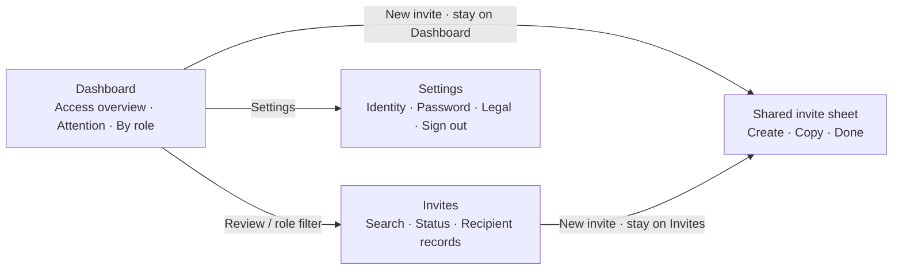

# Admin workspace redesign — revision 3

**Presentation superseded by [revision 4](admin-ui-visual-refinement-plan.md): the user rejected this visual design as generic. Retain this document as functional/security and verification history.**

Date: 9 November 2026. Status: **Implemented by the existing Luna agent; primary source review and automated verification passed. Device/rendered acceptance remains outstanding.**

This specification supersedes the Admin presentation/navigation decisions in `admin-ui-registration-plan.md`. Its registration security, invite cache, RLS boundaries, and prior test history remain valid. Do not repeat the first pass as a spacing cleanup.

## Why the first implementation was rejected

The user reports that the change still looks and behaves like the old Admin: a white screen with two metrics and repeated invite rows, an inconsistent bottom bar, no Settings, a visible dashboard logout button, and New invite navigating away. Source review confirms those structural problems. Passing TypeScript/tests did not establish that the intended design was delivered.

The correction must be recognizable through screen composition, color coverage, navigation, and task flow. It must give each screen a distinct responsibility.

## Ownership and scope

- Primary agent decides and reviews all product/layout changes. Reuse `/root/luna` with its already accepted `gpt-6-luna` / `xhigh` configuration for implementation and corrections. **Create no agents.**
- Preserve unrelated dirty-tree work and the prior registration/server changes.
- No database migrations, new account-management APIs, role conversion, or hosted deployment. An invitation list is not a list of currently active officials; do not invent account totals, coverage, health scores, or availability toggles.
- Keep existing Admin authorization and its user-scoped in-memory cache, freshness/deduplication, expired-row filtering, mutation invalidation, and stale-response protection.
- Both Android and iOS must support every action, keyboard, safe area, modal/back interaction, and enlarged text.

## 1. Navigation and responsibility

| Destination | Responsibility | Must not contain |
| --- | --- | --- |
| **Dashboard** (`/admin`) | Access summary, approaching expiry, role breakdown, direct invite creation. | Recipient/invitation record list, logout button, a second copy of Invites. |
| **Invites** (`/admin/invitations`) | Find, filter, inspect, create, and revoke actual invitation records. | Another dashboard/role-summary section, placeholder account management. |
| **Settings** (`/admin/settings`) | Administrator identity, password, privacy/terms, version, confirmed sign-out. | Fake notification switches, operational official preferences, account conversion. |

- Replace the visible Accounts destination with Settings. Keep `/admin/accounts` as a compatibility redirect to `/admin/settings`; remove the placeholder screen.
- Use the **actual MDRRMO/BDRRMO floating bottom-bar geometry** from `officialBottomNav.styles.ts`: 8px side inset, fully rounded 24px bar, 78px content height plus bottom safe-area inset, subtle border/shadow, navy selected icon, normal dark inactive icon, matching label sizes/weights.
- Reuse `officialNavMetrics`, `officialNavColors`, and role-neutral bar/item styles where safe. Keep `AdminBottomNav` responsible for Admin's three routes and events; never import official role context or operational behavior. No raised center action. No old edge-to-edge bar, pale selection circle, negative safe-area offset, or separate invented navigation style.
- Use filled/outline active/inactive icons as the official bar does: `grid`/`grid-outline`, `mail`/`mail-outline`, `settings`/`settings-outline`. Preserve safe areas, accessibility state, tab events, and haptics.
- The current SDK 58 official layout explicitly warns that `href: null` redirects. Follow its custom-navigation omission pattern for the compatibility route; do not introduce that hidden-route workaround.

## 2. Concrete visual system

The old white canvas plus tiny indigo tiles is rejected. Admin must have a visible wash across the **whole screen**, including safe areas and tab scene backgrounds.

Centralize a small exported `adminColors` palette in the existing Admin style module, used across all three routes and Admin components:

| Use | Color/source |
| --- | --- |
| Full canvas | `#EDF3F9`, already used in Resident Home. |
| Primary light-blue panels | `#EAF3FC`, the existing official navigation carve color. |
| Main access-panel wash | `#D6E5F5`, a stronger pale-blue wash so the hero is visibly distinct from the canvas. |
| Mint success/registered panels | `#ECFDF5`, the existing Admin success fill. |
| Warm attention panels | `#FBF0E4`, the existing Resident avatar fill. |
| Main ink and primary action | Shared `colors.navigationActive`. |
| Secondary ink | Shared `colors.textMuted`. |
| White surfaces | Shared `colors.white`. |
| Registered ink | Existing `#047857`. |
| Attention ink | `#885B2F`, centralized and checked against its warm fill. |

- These are meaningful large surfaces, not tiny icon backgrounds on an otherwise unchanged white page. Keep backgrounds quiet and text dark.
- Color review found the canvas `#EDF3F9` and the original light-blue fill `#EAF3FC` have effectively equal luminance. Use the stronger access-panel wash for the main hero; keep the existing light blue for secondary marks. Blue/mint/warm text combinations were calculated above 5:1 (navy on light blue above 14:1). Do not let the main panel disappear into an almost identical canvas.
- Add `radius.xxl = 24` if needed as an additive token; use it for the main access panel and Settings groups. Do not change any existing theme value or restyle other roles.
- All app text uses existing Inter families. Page titles 24px semibold, primary numbers about 36px bold, section titles 16px semibold, body 14px regular, metadata 12px. Typography must scale; do not lock number panels to a height that clips enlarged text.
- Use 20–24px page gutters, 16px panel padding, 12–16px related-item gaps and 24px section gaps from existing spacing tokens. Max content width 640px, centered on tablets/web.
- Headers are compact: existing municipal seal or shield mark at left, Admin identity and page title, a gear action to Settings on Dashboard. No dashboard logout and no lengthy tutorial copy.
- Use subtle native shadow/border depth on white surfaces; blue/mint/warm grouped panels provide visual hierarchy. Avoid gradients, random stock imagery, decorative charts, large hero paragraphs, and mixed icon families.

## 3. Dashboard: compose a dashboard, not a shorter invite list

Order and composition:

1. **Header:** Admin/Dashboard identity, gear button to Settings.
2. **Access overview panel:** one broad pale-blue rounded panel. A small shield/link motif made from existing Ionicons provides a visual anchor. Within the panel, two clearly labeled stages:
   - **Pending**: current active/unexpired invitation count.
   - **Registered**: used-invitation count, not active-account count.
   Labels/status badges appear above/next to their own large numbers in the main visual area, not as small chips on the far right. Connect stages with a subtle directional line/arrow if useful; it is an access pipeline, not a fabricated progress percentage.
   The panel contains one navy **New invite** action.
3. **Needs attention:** a compact warm panel when an unused invite expires in the next **48 hours**. Show the count and **Review**; tapping opens Invites with pending + expiring filter applied. With a valid snapshot and none expiring, show a quiet positive line **No invites expiring soon**. Without a snapshot show a skeleton/error, never a false zero/healthy state.
4. **By role:** three small rows/cards for Mayor, MDRRMO, and BDRRMO. Each shows actual pending/registered invitation counts derived from the shared snapshot, with a simple proportional rail or paired count badges. Use a short shared legend/header rather than repeating explanatory sentences. Tapping a role opens that role's filtered Invites view.

At widths below 360px or a font scale of at least 1.4, stack each role name above wrapping, individually labeled Pending/Registered counts and hide the column legend. Let the warm attention panel wrap with Review on its own row. Fixed count columns must not squeeze the role name or the action out of a small phone layout.

**No recent recipient rows at all.** Remove the previous Recent section, its list mapping, and all dashboard logout code/imports. The Dashboard must look different from Invites at a glance, even without reading labels.

### Direct creation is required

- Dashboard **New invite** sets local presentation state and mounts the existing `AdminInviteFormSheet` on the Dashboard. It must not call `router.push/navigate/replace`, switch tabs, or change the route.
- The same form component is reused on Invites. Make its `onPresented` callback optional if useful; do not copy the form and do not put presentation state into the data cache.
- Closing returns to the same screen with the same scroll/filter state. Success refreshes the shared snapshot and keeps the one-time link available for explicit copy; closing before copying retains the existing discard confirmation.
- Opening the form works with cached data, while a list is loading, and after a list fetch failure. Form capability must not depend on invitation-list success.

## 4. Invites: a working management screen

- Keep a virtualized list, shared cached data, and retained content during refresh.
- Header title **Invites**, a compact **New invite** action, and an actual search field for email/barangay/role. Search/filtering is local and memoized; no database calls on typing, filter changes, or presentation changes.
- Two primary status segments: **Pending** and **Registered**, with real counts once a snapshot exists. Use a loading/unknown label before that. Screen-reader labels say counts are loading/unavailable, not an em dash read as a count.
- Use a compact filter action/panel for Role (All/Mayor/MDRRMO/BDRRMO) and expiry (Any/Next 48 hours, pending only). Show active filter chips with a clear/reset affordance; do not permanently dump every filter option into the screen.
- Dashboard links apply `group`, `role`, and optional `expiry=soon` route values. Validate all accepted query values locally; unknown values fall back safely. Apply these values as filter state without effect-driven resets that fight React lint or user edits.
- **Status is leading content in every record:** recipient email first, then a left-aligned status badge immediately below/alongside it. Pending uses blue, Registered mint, Expiring soon warm. It must remain visible before expanding. Do not put status only at the far-right edge of a long role row.
- Next line: role and barangay. Short date metadata (Expires/Registered) and masked mobile follow with natural wrapping. Expiry status is derived from dates; do not invent revoked/expired history which the existing list RPC does not return.
- Whole row/header can expand for created date/full information and the existing confirmed revoke action. Avoid duplicate More details controls. Used/registered links cannot be revoked or copied again through an unavailable token.
- Preserve row pending/error feedback, auth denial clearing, unmount guards, refresh reconciliation, and explicit empty/error/retry states. An empty filtered result has **No matching invites** plus **Clear filters**; distinguish it from an empty database.

## 5. Settings: real account actions

Add `app/admin/settings.tsx` under the existing protected Admin shell.

- Identity panel: actual signed-in administrator name/email, **System administrator** role label, existing app municipality context. Reuse `fetchMyOfficialPublicProfile` (it reads the current user's safe `app_profiles_public` row without an official-only role gate), `getActiveSession`, and `ProfileAvatar` in read-only mode as appropriate. No invented person name or editable role.
- Fetch only on first visit/mount and explicit retry; retain the mounted tab's identity snapshot. Do not refetch on every focus, keystroke, or sheet open. Protect state against logout/unmount and show an identity skeleton/Retry without blocking legal or sign-out actions.
- **Password & access:** reuse `OfficialPasswordModal` and `changeOfficialPassword`, which reauthenticates the current email account and does not require mayor/officer scope. Preserve validation, pending state, feedback and the existing sign-out-on-success behavior. No new credential storage, service key, or weakened verification.
- **Privacy notice** and **Terms:** reuse `LegalModal` and its current contents.
- **App version:** actual `Constants.expoConfig?.version`, informational unless there is a useful existing action. Do not show implementation/SDK details to users.
- **Log out:** bottom session section, destructive-tone icon/label, confirmation, synchronous duplicate guard, pending/error feedback, then official sign-in. Dashboard has no sign-out control.
- Use grouped white panels on the pale canvas with leading icons and trailing chevrons only for functioning actions. No fake preferences/toggles, no operational official workspace rows, no clickable unavailable tools.

## 6. Implementation boundaries and reuse

Expected edits: Admin routes/layout/navigation/styles; `AdminPageHeader`, `AdminInviteRow`, `AdminInviteFormSheet`; `AdminScreenSkeletons`; `lib/adminInvitePolicy.ts` and its focused tests; additive radius token only if needed. Add a focused filter sheet/presentation component only where it has a clear responsibility.

- Keep Dashboard summaries/filter/expiry calculations in the existing admin policy module where they can be tested. Reuse `formatInviteKind` for role mapping; no repeated nested role ternaries.
- Compute the current time through the existing cache clock/pattern, not a new polling fetch. Expose a clock/snapshot timestamp from the provider if needed for consistent 48-hour categorization. An expiry-derived UI change must not trigger database polling.
- Do not change invite creation/consumption contracts, registration hooks, backend functions, or database schema for this design revision.
- Match skeletons to the new hero/attention/role layout and new Settings identity. No old Recent-row skeleton on the Dashboard. Keep static navigation and available actions visible while data loads.
- Keep `AdminInviteRow` focused on invitation records. Once Dashboard no longer uses it, remove its unused recent/list variant API and dead presentation code/styles.
- Preserve first-pass cache, race, auth, clipboard, keyboard, and token safeguards; do not discard them to make the layout simpler.
- Avoid synchronous state-reset effects and render-time ref/time mutations; use event ownership/derived state and existing lint-compatible lifecycle patterns.

## 7. Review gates and verification

The redesign is not accepted merely because checks pass. Primary must verify these structural differences in the source and, where the environment permits, the rendered UI:

| User complaint | Required evidence |
| --- | --- |
| Color theme unchanged | Pale canvas covers all Admin routes, safe areas, and scenes; blue/mint/warm panels visibly organize content. |
| Layout unchanged | Dashboard has access panel + attention + role breakdown; no recipient list. Invites is the searchable record workspace. |
| Status hidden far right | Stage statuses visible in the dashboard's main panel; record status below the recipient, left-aligned and visible collapsed. |
| Nav differs from roles | Actual official bar metrics/base styles reused; Settings replaces Accounts; correct safe-area geometry. |
| No Settings / dashboard logout | Settings has real identity/password/legal/logout actions; no logout UI or code in Dashboard. |
| New invite navigates | Dashboard handler opens local sheet, without Router calls; dismissal keeps Dashboard selected. |
| Redundant screens | No Dashboard recipient list; Invites has no duplicate role/hero dashboard sections. |

Verification:

- Capture a scoped pre-rework baseline so earlier dirty work is not confused with this revision.
- Add meaningful policy tests for 48-hour expiry boundaries, malformed/used dates, role mapping, summary reconciliation, and combined query/filter behavior. Reuse the existing Node test script; no tests that just assert source strings/styles.
- Run `npm.cmd run test:unit`, `npm.cmd run typecheck`, and `npm.cmd run lint`; separate the two known `lib/publicIncidents.ts` warnings from new errors.
- Run task-specific `git diff --check` and inspect the diff against the rework baseline.
- Verify Android/iOS/web bundling after final changes. Prior bundle outputs do not verify the new Settings route. Build into ignored `dist/` and use the already approved narrow Expo export command if the sandbox blocks Hermes.
- Manual acceptance: direct create/dismiss/copy from BOTH Dashboard and Invites; deep-link role/expiry filters; local search and reset; cold/stale/failed data; identity failure with working Settings actions; password reauth/feedback; confirmed logout and account switch; Android hardware/modal back; iOS keyboard; small phone and enlarged text; bottom gesture/three-button insets.
- Do not claim screenshots/device/SMS/password submission were verified without observing them. Browser automation failed in the prior task; retry only through allowed tools and record its actual result.

## 8. Decision and execution log

### Revision 3 file inventory

| Files | Change and reason |
| --- | --- |
| `app/admin/index.tsx` | Distinct summary/attention/role Dashboard; create sheet opens locally; removed repeated recipient list and logout. |
| `app/admin/invitations.tsx` | Memoized local search, status/role/expiry filtering, explicit states, keyboard handling and retained record actions. |
| `app/admin/settings.tsx` | New actual identity, password, legal, version and confirmed logout screen, using existing account helpers/modals. |
| `app/admin/_layout.tsx`, `app/admin/accounts.tsx` | Protected three-destination shell, pale scene background and legacy Accounts compatibility redirect. |
| `components/navigation/AdminBottomNav.tsx` | Reused official navigation geometry/colors/base styles with Admin destinations and selected icons. |
| `styles/components/adminBottomNav.styles.ts` | Removed the unused separate legacy Admin navigation stylesheet. |
| `components/admin/AdminPageHeader.tsx`, `AdminInviteRow.tsx` | Compact common identity header and record-only rows with leading, collapsed-visible status. Removed the unused recent-row variant. |
| `components/admin/AdminInviteFormSheet.tsx` | Reused the same secure form on both screens; optional presentation callback supports local opening. |
| `components/admin/AdminInviteFiltersSheet.tsx` | Focused draft/apply/reset role and expiry controls with native modal dismissal. |
| `components/ui/AdminScreenSkeletons.tsx` | Skeleton shapes match the new Dashboard and Settings identity layouts. |
| `context/AdminInvitesContext.tsx` | Exposed the existing snapshot clock and scheduled local expiry-window transitions; retained shared user-scoped freshness and mutation guards. |
| `lib/adminInvitePolicy.ts`, `tests/adminInvitePolicy.test.ts` | Reusable expiry, role-summary and generic local-filter calculations with meaningful boundary/filter tests. |
| `styles/screens/admin.styles.ts`, `styles/theme.ts` | Central Admin surface palette and layout styles; additive `radius.xxl` token only. Existing Inter families retained. |
| `docs/admin-ui-rework-plan.md`, `docs/admin-ui-registration-plan.md` | Current decisions, implementation/review history, validation limits and explicit supersession of the first-pass Admin design. |

The inventory describes this revision's feature scope, not every dirty file in the repository. Earlier registration/backend work and unrelated Resident/official work remain separate.

| ID | Decision | Status |
| --- | --- | --- |
| R3-01 | Distinct Dashboard, Invites, Settings; legacy Accounts redirects. | Implemented; source reviewed |
| R3-02 | Whole-canvas wash, larger rounded access/group panels, semantic blue/mint/warm palette. | Implemented; source reviewed; rendered acceptance pending |
| R3-03 | Official floating navigation geometry/styles; no separate old Admin bar. | Implemented; shared tokens/styles verified |
| R3-04 | Dashboard opens the shared create sheet locally; no tab/route change. | Implemented; local handler verified |
| R3-05 | Leading visible link statuses and useful local search/filters. | Implemented; source and policy tests reviewed |
| R3-06 | Real administrator Settings and confirmed logout, with secure existing password flow. | Implemented; source reviewed; real credential actions unsubmitted |
| R3-07 | Preserve registration/security/cache work; no backend/schema/deployment changes. | Retained within this revision's scope |

| Phase/date | Owner | Actual changed files/behavior | Checks | Remaining |
| --- | --- | --- | --- | --- |
| 2026-11-09 / re-audit and plan | Primary | Rejected superficial first-pass composition after the user's feedback; inspected actual Admin, official navigation/Settings, auth/profile utilities and SDK 58 hidden-route caveat; created this revised specification. | Source review. | Luna implementation and primary review; rendered/device acceptance is not yet established. |
| 2026-11-09 / palette review | Primary | Distinguished the main access panel from the canvas with `#D6E5F5`; retained existing role-compatible blue, mint, warm, and navy values for the rest of the palette. | Calculated text contrast for blue/mint/warm combinations; found the two original pale blues were too similar for a main-panel boundary. | Confirm actual source uses the distinct hero wash and whole-canvas fill. |
| 2026-11-09 / implementation and review | Existing Luna / Primary | Replaced the repeated overview list with access stages, local creation, expiry attention and role counts; added searchable/filterable Invites, actual Settings, Accounts redirect, leading record status and shared official navigation. Updated Admin palette and skeletons; retained the prior cache/security boundaries. | Unit suite: 181/181 passed. First typecheck found three stale access-state style references and nullable list-empty content; first lint found an identity-load lifecycle issue and one new array-style warning. Corrections and final checks are in progress. | Final type/lint and new Android/iOS/web export; rendered and device interactions remain unobserved. |
| 2026-11-09 / narrow-screen review | Primary | Identified fixed role-count columns and the attention row as cramped at small widths/enlarged text; specified a stacked layout below 360px or at font scale 1.4. | Source geometry review; no device screenshot claimed. | Luna implementation and final source review. |
| 2026-11-09 / browser availability | Primary | Retried the allowed computer-use surface inventory; browser host remains unavailable and no browser surfaces were exposed. | Inventory only; no rendered Admin screenshots or physical-device actions observed. | Android/iOS device acceptance checklist above. |
| 2026-11-09 / source corrections | Existing Luna / Primary | Corrected the four type integration issues; split identity fetching from state application without effect-lint suppression or timers; fixed the new array-style warning and header indentation; delivered the specified narrow/enlarged Dashboard layouts. | Primary re-read final handlers, policy generics, expiry timer, status placement, Settings lifecycle and compact layouts. Scoped tracked-file whitespace check passed. | Final automated check results recorded below when complete. |
| 2026-11-09 / final verification | Primary | Accepted the implemented structure against all seven complaint gates; verified the pale scene/canvas palette, shared official nav, local Dashboard form, leading record status, separate record workspace and real Settings actions in source. No further source changes after the final checks began. | Unit suite **181/181 passed**. Final **typecheck passed**. Final **lint passed**, including Deno checks of 26 files; only the two existing array-style warnings in `lib/publicIncidents.ts:81–82` remain. Final **iOS, Android and web export passed**, including `/admin/settings`, `/admin/invitations`, `/admin/accounts` and `/admin`. Logs: `dist/admin-rework-unit.log`, `dist/admin-rework-typecheck-final.log`, `dist/admin-rework-lint-final.log`, `dist/admin-rework-export-final.log`; output: `dist/admin-ui-rework-export/` (ignored local artifacts). | Physical-device/rendered acceptance and real create/revoke/password/logout/SMS actions remain unobserved. No backend deployment performed for this revision. |

### Primary review outcome

The implemented plan resolves the structural causes of the rejected design: Dashboard no longer duplicates recipient records; creation is local to the current screen; status is leading content; actual shared official navigation leads to functional Settings. The new palette covers complete scenes and meaningful panels. Local filters and expiry transitions operate on the shared snapshot, preserving the existing 60-second freshness policy and avoiding database requests for those presentation changes. This is source/build acceptance, not a claim of observed visual quality on a device.

To review the new routes and styles on a device, restart Metro with `npm start -- --clear` and fully reload Expo Go. Follow the manual acceptance list in section 7 on **both Android and iOS**. If later feedback changes the design, append a new revision/decision here before implementation; do not silently restore the superseded first-pass composition.

Baseline limitation: the pre-rework source/check findings were captured in the earlier agent/tool conversation, not saved as a separate source snapshot. The recorded baseline was 177 passing unit tests, passing typecheck and lint with two existing warnings. A byte-for-byte first-pass source diff cannot be reproduced from a saved artifact; do not invent one. Final review uses the documented source findings, current source and task-scoped Git diff, which also contains earlier work in this feature.

For each completed phase, append the actual files, behavior changes, check results, and any deviation reviewed by primary. Preserve earlier history; make current status explicit so a later model does not implement superseded layout decisions.
