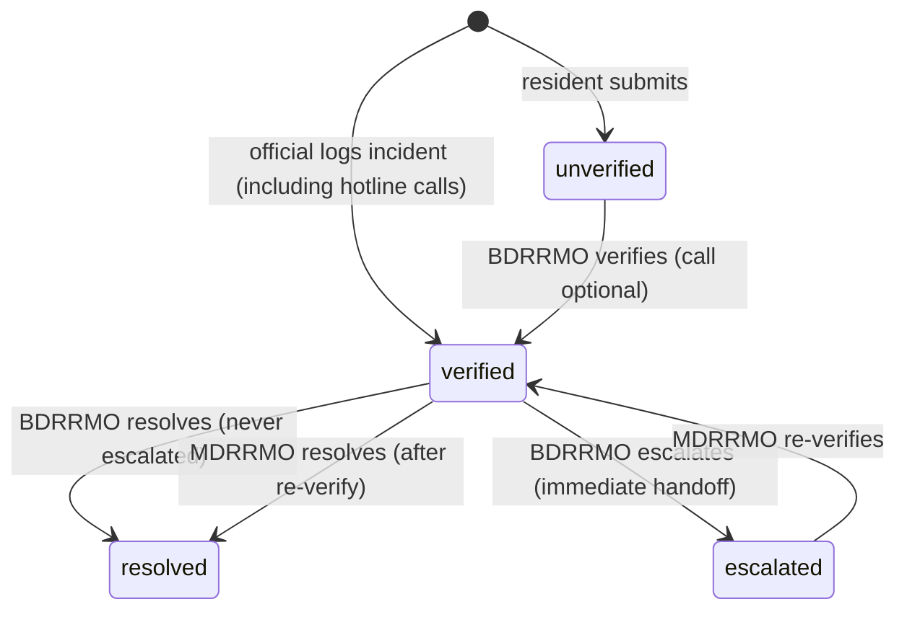
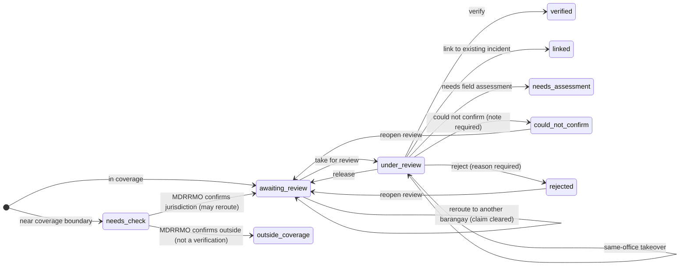
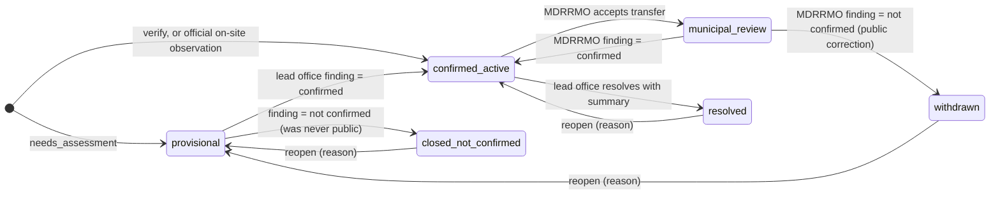
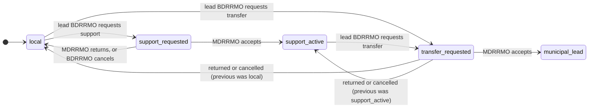

# DisasterLink — Report Lifecycle Review and Response-Flow Implementation Plan

| Item | Value |
| --- | --- |
| Revision | **3 + owner amendments** — original decisions 29 October 2026; Phase 4 status audited 8 November 2026. Read the current audit below before implementing or reporting completion. |
| Source of the proposed flow | `DisasterLink_Proposed_Report_Flow.png` (steps A, 01–16, and "Rules across all branches") |
| Related earlier documents | `docs/DisasterLink_Resident_Report_Incident_Case_Implementation_Plan.docx`, `docs/DisasterLink_Workflow_Research_and_Recommendation_Assessment.docx` |
| Plan status | **Phase 4 implementation and controlled-test deployment are complete; Phase 4 acceptance is not.** Migrations `20261108000000`, `20261109000000` and `20261110000000`, plus the `create-official-report` / `process-public-report-photo` Edge Functions, are deployed. Local client/database/media checks and hosted rollback, function/ACL parity and unchanged-source checks pass. Physical-iPhone acceptance, R5, G1 signatures and manuscript alignment remain pending. Phase 3 implementation is deployed; operational acceptance remains pending. Phases 5-6 remain unimplemented. |
| Code written | Phases 0-3 plus Phase 4 private reports, limited public incidents, discussion/support, publication controls, resident lifecycle/timeline/outcome notices, safe notifications, transactional confirmation/publication, safe photo copies and per-report media projections. Phase 3 and Phase 4 UI/UX work used GPT-6 Astra Medium. |
| Stakeholder review scheduling | **Deferred by owner on 30 October 2026 until next week's meeting; exact date to be confirmed.** Phase 2 stays deployed. Phase 3 implementation and controlled local testing may continue. G1 signatures and manuscript alignment remain pending before operational Phase 3 release, together with R5. See `docs/verification-operating-rules.md`. |

---

## Current Phase 4 audit and handoff — 8 November 2026

**This audit takes precedence over older implementation claims and conflicting
public-data rules below. Deployment, passing automated tests, and owner-requested
UI corrections do not mean Phase 4 is complete.** Original dated records are
historical evidence; do not present them as current acceptance.

### Current implementation versus the agreed outcome

**Implementation update, 8 November:** confirmation-time screened publication,
the shared screening UI, metadata-safe photo processor, immutable derivative
registry, and per-report public-photo projections are deployed. Migrations
`20261108000000` and `20261109000000` and the `create-official-report` and
`process-public-report-photo` Edge Functions are on the hosted project. Local
validation passed: 158 unit tests, 766 SQL assertions and a separate 72-check
resident cutover suite, SQL lint, TypeScript, ESLint/Deno lint, per-function
Deno checks, and Expo web export. The real local Auth/Storage/Edge harness passed
including concurrent idempotent confirmation, linked-photo isolation, official
intake photo retry, metadata stripping, original privacy, reprocessing revocation,
and hide/replay behavior. Hosted catalog/function parity, RLS/ACL, Edge
CORS/auth-denial and rollback checks pass. Two rollback-only SQL files report
37 TAP results, including 36 atomic/RLS checks and a pass wrapper for the existing
50 publication-security guards. A test-only runner fix uses `SET LOCAL ROLE
postgres`; application grants and hosted data were unchanged. The 080/090
post-rollback snapshot was unchanged. A later read-only preflight for the 110
amendment observed 32 reports, 11 incidents, 65 media records and zero
individually published posts; its post-deployment source snapshot matches.
Physical-iPhone, R5 and G1 acceptance remain pending.

### Owner amendment — authoritative source text and compact review (8 November 2026)

Resident public title and description now mirror the submitted report source.
The confirmation, link, finding and publication-review screens show the source
in a compact, expandable read-only card; they no longer offer an edited public
copy. The append-only `20261110000000_resident_report_text_integrity.sql`
migration freezes resident title, description, reporter and intake provenance,
derives publication text from the stored report, rejects mismatched publish
overrides, and leaves existing publication rows untouched. Hide calls ignore
stale text overrides. The migration and updated `create-official-report` Edge
Function are deployed to the hosted project; rollback, parity, source-fingerprint
and access checks pass.

On-site official intake keeps its optional title. In the new transactional
publication flow, a blank official title receives the deterministic public
incident-type label before the source report is stored; the public post then
mirrors that stored official source. This fallback never changes resident text.

Review controls use compact disclosure tiles and clear photo visibility states.
Full-size photo review retains the safety checklist, and sensitive cases still
require an internal reason. Releasing a review asks for confirmation. Repeating
the selected confirmation choice keeps its loaded form; failed publication
lookups have an explicit retry action. The shared form sheet now has one
vertical scroll owner and review notes do not capture sheet drags. This scroll
fix is source-inferred from the prior nested responder/layout structure; it has
not been reproduced on a physical phone. Local validation now passes: the full
162-test npm suite, 799 SQL assertions across 12 files (including 33 new source
integrity checks), Deno check, web export and real local media harness. The new
migration and updated Edge Function are deployed. Hosted tests pass with 70 TAP
results across three rollback-only files: 33 integrity checks, 36 atomic checks
and one wrapper for the 50 publication-security guards. All 19 checked function
definitions, constraints, trigger state and permissions match local validation;
function fingerprint `cd2c5bd5fb17d823fdb61be672b059da`. Report/media counts and
fingerprints match before and after deployment; no existing posts were published.
TypeScript and lint pass, with two existing array-type style warnings. Physical-iPhone
normal/enlarged-text acceptance, R5, G1 signatures and operational acceptance
remain open.

| Area | Current implementation | Status / required outcome |
| --- | --- | --- |
| Resident submission and original evidence | Owner and authorized officials retain private source-report access. Submission/offline queue preserve sharing choices. | Implemented; preserve source RLS and original evidence. |
| Resident public choices | Two switches in the final review-timeline section: name/profile picture together, exact incident location separately. Database consent fields remain separate for compatibility. | Implemented UI; no automatic identity/location opt-in for existing reports. |
| Sharing editor in report details | Removed from both Your contributions and marker-opened details at the owner's request. | Intentional. Do not restore it or tell testers it exists. Submission still has sharing controls; owner preference RPC remains available, but there is currently no post-submission editor. |
| Individual public reports | `report_public_posts` holds screened text and lead-approved disclosure flags. Limited public projections return only each report's current verified safe photos; legacy incident summaries remain separate fallbacks. | Deployed with 080/090 and the two Edge Functions. Local and hosted parity/ACL checks pass; rollback/media-flow checks pass. |
| BDRRMO confirmation and public visibility | Review, lead-owned confirmed links, field findings and on-site intake submit screened content and publication in one retry-safe transaction. Sensitive cases use the existing safety flag/reason and keep public text, detail and photos hidden. | Deployed. The current official flow combines confirmation and screened publication; it does not require a separate Publish step. |
| Public photos | The processor strips JPEG metadata with a strict parser, writes immutable service-owned display/thumbnail derivatives, binds proof to source and Storage object identities, and permits approval only for current verified copies. Original evidence stays private. Videos remain private. | Deployed. SQL, Deno and synthetic Auth/Storage/Edge checks pass. Physical-device verification remains pending. |
| Media on individual report posts | Public projections expose only current safe photos belonging to that report. Client signing preserves display/thumbnail pairing, short caching, partial failures and revocation refreshes. | Deployed and covered by unit/media-flow tests. Physical-device verification remains pending. |
| Videos | Remain private; no public-video screening/processing path. | Deferred public-video capability; do not promise all confirmed attachments become public. |
| Maps and report summaries | Shared selected triangles/type glyphs, versioned WebView refresh, short barangay metadata, and selectable grouped rounded points. Selected/highlighted resident report markers on Home and Map use a status-colored pulsing halo and slight size increase; the halo indicates selection, not geography. | Implemented code; final physical-iPhone visual acceptance pending. Never invent distinct precise points for rounded locations. |
| Detail content | Owners see private report activity; public readers see shared incident updates/discussion. | Intentional access distinction; make explanations clear without exposing private history. |

### Remaining release and acceptance work (complete before declaring Phase 4 done)

1. **Verify and record acceptance.** Test hosted resident to BDRRMO to another resident on the physical iPhone: confirmation immediately exposes the reviewed post; approved photos appear; identity appears only when owner consent and official approval both allow it; restricted location remains protected; originals are inaccessible; selected halos and compact review controls render correctly with normal/enlarged text. Complete R5 and applicable operational gates. Do not claim UI or phone acceptance from source review or a web build.

### Evidence and limits of this audit

- Migrations `20261108000000` and `20261109000000`, `create-official-report` and `process-public-report-photo` are deployed. Catalog/ACL, CORS/auth checks, 17-function parity and rollback-only SQL assertions passed. Both SQL files reported 37 TAP results, including 36 atomic/RLS checks and one wrapper result for existing security assertions. The runner fix is test-only; no application grants changed. This is not a physical-phone walkthrough or operational release.
- Historical 080/090 post-rollback snapshot recorded 30 reports, 11 incidents and 63 media records with zero individually published posts. The current 110 deployment and rollback tests preserve all 32 reports and 65 media records; the final snapshot has 11 incidents and zero individually published posts. Report fingerprint `bc43a329089fb198ab441e142d8b96d9` and media fingerprint `96a15ffc60210b98bd46a7951dc9b0c5` match the fresh predeployment snapshot. Hosted fixtures were rolled back and no existing reports were auto-published.
- Local unit, SQL, lint, Deno-check, web-export and real Auth/Storage/Edge harness results are listed above. These do not establish visual or phone acceptance.
- Earlier baseline checks include 149 unit tests and 50 rollback-only hosted security assertions. They do not establish the new flow or visual acceptance.
- The last recorded aggregate hosted check found zero individually published posts, name opt-ins and exact-location opt-ins. This is historical; recheck state rather than assuming it remains zero.
- Keep existing reports for compatibility tests. Do not delete them to conceal the mismatch, auto-publish their text/media, or opt them into disclosure.
- Reference: [publication/sharing record](resident-publication-sharing.md), [marker repair](phase4-marker-repair.md), and [phone checklist](phase4-expo-go-test-checklist.md).

## What changed in revision 2

| Review point | Where it is handled now |
| --- | --- |
| Officials' notes and evidence media are exposed through the API | Moved to **Phase 0**, an immediate security fix that is tested on its own (S1–S5). It no longer waits for the redesign. |
| "Older installed app versions keep working" was an assumption | It is now a **testable requirement** (R5). A **minimum-version check** (R2–R4) must be in place before any incompatible status ships, and it can only block an old build once an update is confirmed downloadable (section 5). |
| Residents should know which office is responsible | Rerouting and transfer changes now add **resident timeline entries** (T5, T7, T29). |
| Labels must reflect facts | The label helper now works from explicit facts. Its tests are written as a facts-to-label table (section 2.4, T14). |
| 1 — Take for review | A reviewable **claim** has been added (T5, T16). Another officer in the same office can take it over. It does not confirm anything or create ownership. |
| 2 — "Response ongoing" | Now requires a recorded **qualifying response action** (section 2.5, T6, T14). |
| 3 — Recorded vs. confirmed | A hotline account an official types in is **recorded, not confirmed**. Only an official's own on-site observation starts confirmed (T8, T24). |
| 4 — Hotline / assistance / dispatch | These are three separate event types. "Dispatch confirmed" requires the officer to record who at the service confirmed it (section 2.5, T6, T19). |
| 5 — Provisional case coordination | The allowed transitions are now explicit (section 2.2). |
| 6 — Coverage check | A **two-tier** check. Locations near the boundary go to MDRRMO, which only checks jurisdiction and routing; that check is not verification (T5, T17, T29). |
| 7 — Public data | A **limited public incident record** replaces readable report rows. Photos appear publicly only after an official explicitly approves each one (section 2.6, T9, T26–T28). |
| 8 — MDRRMO does not confirm a public case | The public record shows a **correction notice**, the change is audited, and every linked reporter is notified (T7, T23). |
| 9 — Migration and legacy order | The legacy wrapper (T11) now runs after the functions it calls. Historical escalations keep a **"legacy — acceptance not recorded"** label (T10). |
| 10 — Fabricated resolution summary | Removed. Legacy resolutions stay "outcome summary not yet posted" until an official adds one (T7, T11). |
| 11 — Point person | The field has been removed. The review claim shows who is handling a report; the office owns the incident (T2, T20). |
| 12 — Mayor watchlist | Kept, with a privacy-limited pending summary (T31). |
| 13 — Mayor update requests | Now one **tracked office-level request** with acknowledgment and an answer. No repeated notifications (T9, T32). |
| 14 — Unconfirmed filter | Recorded as **deferred**, with its prerequisites (section 7). |
| Optional call | Now both a design change and a **signed operating rule** for BDRRMO/MDRRMO and your adviser (G1). |

### What changed in revision 3

| Decision | Where it is handled now |
| --- | --- |
| Q1 — Hide unverified reports from other residents in Phase 0 | S5 is now mandatory. `can_read_report` for residents becomes own report, or `status <> 'unverified'`. Comments and upvotes follow the same rule. |
| Q2 — Approximate public area; exact pin only for a safety message; sensitive cases stay coarse | Section 2.6, T2 (`public_location_mode`, `is_sensitive`), T26, T28. The map must label an approximate area as approximate. |
| Q3 — Comments belong to the confirmed incident | T26: discussion is keyed to `incident_case_id`. A private source report is never made readable just to keep old comments. |
| Q4 — Mayor sees pending summaries plus official timelines, not contact or raw evidence | Section 2.7, T31. Public-approved photos are the Mayor's normal visual evidence. |
| Q5 — Preserve the re-verification finding; do not invent acceptance | T10: keep `reverified_by/at` and `municipal_finding`; mark the handoff as a **legacy handoff whose separate acceptance was not recorded**. No `accepted` support-request row is inserted. |
| Q6 — Correction marker for 7 days; former link still explains the correction | T7, T26, T28. Sensitive withdrawn incidents do not keep a public page. |
| Q7 — Current testing is a physical iPhone through Expo Go | Section 5 and R4–R5. No standalone `1.0.0` distribution files were found in this repository. The old-build checklist now covers installs that cannot receive the version gate. |
| Approved display photos vs original evidence | Section 2.6 and T27: other residents never select `report_media` or original files. They receive only approved `display`/`thumbnail` paths from the public-incident RPC, then sign those paths. |
| Placeholder package ID | R1: replace `com.yourcompany.disasterlink` before any wider standalone distribution. |

---

## How to use this plan

- Work through the phases in order. Each phase must pass its gate before the next one goes live:
  - **Phase 0:** security fix. Ship it now; it doesn't depend on anything else.
  - **Phase 1:** release safety and operating rules.
  - **Phase 2:** database foundation. Deployed but not yet used by the app, and visibly unchanged for users.
  - **Phase 3:** official workflow.
  - **Phase 4:** resident and public cutover.
  - **Phase 5:** Mayor oversight.
  - **Phase 6:** tests, retiring legacy code, and documentation.
- Each task lists **Files**, **Signatures** (no bodies), **State transitions**, **UI**, and **Done when**.
- Tags such as `Decided by D2` or `Q3` point to the decision tables in section 3. Q1–Q7 are decided in section 3.4.
- Old task numbers (revision 1) map to new ones in section 8.

---

## 1. Review of the current report lifecycle

### 1.1 Actors

| Actor | How the code identifies them | What they can do with reports today |
| --- | --- | --- |
| Resident | `app_profiles.role = 'resident'` | Submit (photo and video required). See every report on the map and feed, including its evidence media. Comment, upvote, and edit their own non-status fields. |
| BDRRMO | `role = 'officer'`, `barangay_id` set | Sees reports in its own barangay that are not `escalated`. Can verify, resolve (if never escalated), escalate, correct a location within its own barangay, and reveal the reporter's phone. |
| MDRRMO | `role = 'officer'`, `barangay_id` null | Sees all reports. Can re-verify escalated reports, resolve re-verified ones, correct location and barangay, and reveal the reporter's phone. |
| Mayor | `role = 'mayor'` | Read-only. Sees full report detail, analytics, situations, a watchlist of individual pending reports, and the map. |
| Admin | `role = 'admin'` | Manages official accounts and invites. |

### 1.2 Where the lifecycle is enforced

| Concern | Location |
| --- | --- |
| Status enum and attribution columns | `supabase/migrations/20250617000200_reports_media_history.sql` |
| Insert-time status (residents start `unverified`; officials start `verified`) | `normalize_report_on_insert()` |
| Only status-change path | `transition_report_status(uuid, report_status, text)` in `20260728000000_official_incident_operations.sql` |
| Guard against direct edits and re-escalation | `guard_report_status_columns()` in `20260801000003_...` |
| BDRRMO loses access after escalation | `20260927000000_bdrrmo_hide_escalated_reports.sql` |
| History log | `log_report_changes()` writes `report_status_history` |
| Who can read a report and its related rows | `can_read_report`, `can_read_report_id` (BDRRMO limited to its barangay; **everyone else, including residents, gets `true`**) |
| Media read | `can_read_report_media_path()` (`20260916000000_private_media_derivative_read.sql`) and the `report-media read authenticated` storage policy, both based on `can_read_report_id` |
| Resident notifications | `create_report_activity_notification()` |
| Reporter contact | `preview_reporter_contact`, `request_reporter_contact` (audited), `can_request_reporter_contact` |
| Client mirrors | `lib/officialReports.ts`, `lib/reports.ts`, `components/report/ReportStatusTimeline.tsx`, `components/report/ReportDetailCard.tsx`, `lib/mayorStatusLabels.ts` |

### 1.3 Current state machine



### 1.4 Paths today

1. **Intake.**
   - The resident's report goes into the offline queue (`lib/reportQueue.ts`), which hands it to `lib/reportQueueFlush.ts`, which calls the `create-report` edge function.
   - That function applies a rough bounding-box check and routes the report by the resident-confirmed barangay, falling back to the nearest centroid.
   - The report starts `unverified`. A location outside the box gets a raw error with no contact information.
2. **Local path.** BDRRMO reviews on `app/official/[id].tsx` (calling the reporter is optional; the reveal is logged but the outcome isn't), then marks the report verified, then resolved.
3. **Escalation path.** BDRRMO escalates, and the report immediately disappears from every BDRRMO view. The resident sees "Municipal review" before anyone at MDRRMO has acted. MDRRMO re-verifies, then resolves.
4. **Official-logged incident.** `app/official/log-incident.tsx` calls `create-official-report`. The report starts `verified` even if the official is only typing in a caller's account.
5. **Corrections.** Officers can move the pin. A BDRRMO cannot move a report to another barangay; MDRRMO can.

There is **no** way to reject a report, close it as could-not-confirm, link it to an existing incident, take it for review, assess it in the field, request support without handing it off, accept or return a request, log response actions, reopen a case, or for the Mayor to request an update.

### 1.5 Findings verified in the code

| ID | Finding | Evidence | Handled in |
| --- | --- | --- | --- |
| F1 | Any signed-in user can read `report_status_history`, including official `note` and `detail` (which can contain old and new coordinates) | Policy uses `can_read_report_id`, which is true for residents | **S1 (immediate)** |
| F2 | Any signed-in user can list `report_media` rows and sign **original, display, and thumbnail** files for every report, including unverified ones | `can_read_report_media_path` and the storage select policy both use `can_read_report_id` | **S2 (immediate)** |
| F3 | Unverified reports, with title, description, exact location, and reporter name, are visible to every resident through `reports_map` | `can_read_report` returns true | **S5 (Phase 0, Q1)** |
| F4 | Reporter phone numbers are **not** directly readable | `profiles` rows are limited to the owner; `app_profiles.phone_number` is not granted to clients; reveal is only through an audited RPC | Proved by tests in S4 |
| F5 | The original device GPS is **not** directly readable | `device_location` is excluded from the column grants; only `get_report_location_verification` returns it to scoped officials | Proved by tests in S4 |
| F6 | A BDRRMO cannot fix a wrong-barangay report | `correct_report_incident_location` forces the actor's barangay | T5, T17 |
| F7 | Old builds show an unrecognised status as "Unverified" (official app) or "Under review" (resident app) | `asReportStatus()` in `lib/officialReports.ts` and `getReportStatusPresentation()` in `lib/reports.ts` fall back to the unverified case | R5 and the compatibility gate |
| F8 | The app has no version reporting, no minimum-version check, no `expo-updates`, no `eas.json`, and `app.json` is still at version `1.0.0` | Repository search | R1–R4 |
| F9 | The Mayor already sees individual pending reports | `list_mayor_watchlist` returns unverified reports with title, address, and coordinates | T31 |
| F10 | Status-to-label logic is copied in at least eight places | `ReportDetailCard` (×3), `reports.ts`, `ReportStatusTimeline`, `mayorStatusLabels`, `incidents.tsx`, `[id].tsx`, both workspaces | T14 |

---

## 2. Target flow

### 2.1 How each box in the image maps to the system

| Image step | System behavior |
| --- | --- |
| A, Separate channels | Hotline calls stay outside the app. An official may **record** a caller's account (`intake_channel = 'hotline_call'`). It starts unconfirmed and goes through normal review. |
| 01–02 Submit, Received | Unchanged offline queue. The server stores `review_outcome = 'pending'`. |
| 03 Check scope and barangay | Two-tier coverage check: clearly outside is rejected with hotline guidance; near the boundary goes to an MDRRMO jurisdiction check. Wrong barangay is fixed with an audited reroute. The resident timeline shows the responsible office after each change. |
| 04 Remote review | **Take for review** (a claim), then the evidence panel, link candidates, and optional contact logging. |
| Urgent danger / Response already known | Log a hotline contact, assistance request, or confirmed dispatch, using the vocabulary in section 2.5. Logging never verifies a report. |
| Reject / Could not confirm / Link | Review decisions. A reason is required where stated. |
| 05 Verify | The report becomes a confirmed incident (`confirmation_basis = 'remote_evidence'`). |
| 06–08 Field assessment | A provisional incident (verification `pending`). Coordination is allowed while it is pending. The finding is recorded by the lead office. |
| 09–10 Active incident, lead office | The **office** owns the case. Every action records the individual user. There is no point-person field. |
| 11A / 11B / 11C, 12 | Local response, support request, or transfer request. Acceptance is a separate MDRRMO step, followed by an MDRRMO finding on transfers only. |
| 13–14 | Response events. "Response ongoing" appears only after a qualifying response action. |
| 15 | Resolve with a required public outcome summary. Legacy resolutions are labelled honestly. |
| 16 | Resident outcome notice and timeline. New evidence comes in as a new report that officials link. The lead office can reopen. |

### 2.2 Target state model

There are four separate dimensions plus a review claim:

- **Review claim** (`reports.review_claimed_by/at`): who is reviewing, and since when. This is not ownership and not confirmation.
- **Report review outcome** (`reports.review_outcome`): `pending`, `verified`, `linked`, `needs_assessment`, `could_not_confirm`, `rejected`, or `outside_coverage`.
- **Jurisdiction status** (`reports.jurisdiction_status`): `in_coverage`, `needs_check`, or `outside_coverage`.
- **Incident**:
  - `verification`: `pending`, `confirmed`, or `not_confirmed`.
  - `state`: `active`, `resolved`, or `closed`.
  - `coordination`: `local`, `support_requested`, `support_active`, `transfer_requested`, or `municipal_lead`.
  - Lead office (`barangay` or `municipal`) and `municipal_finding`.





**Coordination transitions.** These are the same whether verification is `pending` (provisional) or `confirmed`:



| Rule | Provisional (verification `pending`) | Confirmed | Resolved / closed |
| --- | --- | --- | --- |
| Request support or transfer | ✅ (step 07: coordinate while pending) | ✅ | ❌ |
| MDRRMO accepts a transfer | ✅. MDRRMO becomes lead and records **the** field finding (one finding, no separate re-verification). | ✅. MDRRMO records the municipal finding. | — |
| Log response events | ✅ | ✅ | ❌ |
| Resolve | ❌ (record a finding first) | ✅ lead office only | — |
| Public visibility | Never | ✅ | Resolved ✅; closed after confirmation shows the correction notice |

### 2.3 Compatibility mapping for `reports.status`

This mapping keeps old builds readable. It does **not** guarantee they behave correctly; that is tested separately in R5.

| New facts | `reports.status` |
| --- | --- |
| Review `pending` (claimed or not), `needs_check`, or `needs_assessment` | `unverified` |
| Incident confirmed, coordination `local`, `support_requested`, or `support_active` | `verified` |
| `transfer_requested`, or `municipal_lead` with no municipal finding | `escalated` |
| `municipal_lead` with finding confirmed | `verified` (with `reverified_by/at` set) |
| Incident `resolved` | `resolved` |
| `could_not_confirm`, `rejected`, `outside_coverage`, or incident closed or withdrawn | **`closed`** (new value; old builds show it as unverified, see F7) |

### 2.4 Facts that decide each label

T14 must test every row of this table.

| # | Facts | Resident (own report) | Official | Mayor |
| --- | --- | --- | --- | --- |
| 1 | pending, not claimed | Awaiting barangay review | Needs review | Awaiting Brgy. X review · waiting 40 min |
| 2 | pending, claimed by A at T | Under review | Under review by A · since T | Under review at Brgy. X |
| 3 | `jurisdiction_status = needs_check` | Checking which office covers this location | Jurisdiction check (MDRRMO) | Jurisdiction check |
| 4 | needs_assessment (provisional) | Being assessed | Being assessed | Being assessed |
| 5 | confirmed, local, **no** qualifying action | Confirmed | Confirmed · no response action recorded | Confirmed · awaiting response action |
| 6 | confirmed, local, qualifying action recorded | Response ongoing | Response ongoing (local) | Brgy. X response ongoing |
| 7 | `support_requested` | same as row 5 or 6 (support is internal) | Support requested · awaiting MDRRMO | MDRRMO support requested |
| 8 | `support_active` | same as row 5 or 6 | MDRRMO supporting | Brgy. X lead · MDRRMO supporting |
| 9 | `transfer_requested` | Forwarded to MDRRMO — Brgy. X remains responsible until MDRRMO accepts | Forwarded · awaiting MDRRMO acceptance | Forwarded to municipal |
| 10 | `municipal_lead`, no finding | Municipal review — MDRRMO is now responsible | Municipal review · finding needed | Awaiting municipal finding |
| 11 | `municipal_lead`, finding confirmed, no new action | Confirmed — MDRRMO responsible | Confirmed (MDRRMO) · no response action recorded | Municipal · awaiting response action |
| 12 | `municipal_lead`, qualifying action | Response ongoing (MDRRMO) | Response ongoing (municipal) | Municipal response ongoing |
| 13 | resolved with summary | Resolved + summary | Resolved | Resolved |
| 14 | resolved, legacy, no summary | Resolved — the office has not posted an outcome summary yet | Resolved · summary missing (action needed) | Resolved · summary missing |
| 15 | MDRRMO finding not confirmed after public confirmation | Withdrawn after municipal review + correction text | Withdrawn · correction posted | Withdrawn |
| 16 | provisional finding not confirmed | Not confirmed (neutral wording) | Closed — not confirmed | count only |
| 17 | could_not_confirm | Could not be confirmed (neutral wording, "send a new report if it changes") | Closed — could not confirm | count only |
| 18 | rejected (reason) | Not accepted: plain-language reason | Closed — rejected (reason) | count only |
| 19 | outside_coverage | Outside DisasterLink coverage, not forwarded to any office + hotlines | Closed — outside coverage | count only |
| 20 | linked | Added to an existing incident (then follows that incident) | Linked to incident | — |
| 21 | legacy escalation (migrated, unaccepted) | Forwarded to MDRRMO | Legacy escalation · MDRRMO acceptance not recorded | Forwarded (legacy) |
| 22 | legacy handoff with preserved `reverified_at` (Q5) | Confirmed — MDRRMO responsible | Legacy handoff · MDRRMO re-verified; separate acceptance not recorded | Municipal (legacy handoff) |

Negative tests (labels that must **not** appear):
- A `hotline_contacted`, `assistance_requested`, `reporter_call` (any outcome), `internal_note`, or `progress_update` event alone never produces "Response ongoing".
- A claim never produces "Confirmed".
- `support_requested` never produces "MDRRMO supporting".
- `transfer_requested` never produces "Municipal review".

### 2.5 Contact and response vocabulary

| Event type | Meaning | Required details | Counts as a qualifying response action? |
| --- | --- | --- | --- |
| `reporter_call` | An official called the reporter | outcome: `reached`, `no_answer`, `call_failed`, or `not_recorded` | No. It is also never verification evidence on its own. |
| `hotline_contacted` | An official contacted an emergency service or hotline | service, outcome (`reached`, `no_answer`, `call_failed`) | No |
| `assistance_requested` | An official asked a service to respond | service, what was requested | No. A request is not a dispatch. |
| `dispatch_confirmed` | The responsible service confirmed it is sending responders | service, **who confirmed** (role or name, up to 80 characters), method (`callback`, `radio`, `in_person`, `written_message`), optional reference | **Yes** |
| `responders_on_site` | Responders are at the location | service or team | **Yes** |
| `assistance_given` | Help was given (evacuation, first aid, supplies) | what was done | **Yes** |
| `work_done` | Operational work (clearing, pumping, barricading) | what was done | **Yes** |
| `external_info` | Duty staff or dispatcher information ("Response already known?") | source | No |
| `internal_note` | Internal coordination note | note | No |
| `progress_update` | A public, plain-language update | text, public | No (it is a message, not an action) |

Services are a fixed list: `bfp`, `pnp`, `rhu_ambulance`, `mdrrmo_rescue`, `bdrrmo_team`, or `other` (with text). Opening the phone dialer records nothing by itself. The official records the outcome afterwards.

### 2.6 Limited public incident record (Q2, Q3, photo access)

**Historical baseline:** the current Phase 4 audit above and the owner's
7–8 November amendments supersede the blanket identity/text restrictions below
for explicitly consented, officially screened individual public posts. Source
rows, unapproved media and original files remain private. Current completion
gaps are listed in the audit; this section is not proof they are resolved.

**Public by default, for confirmed incidents only:**
- Incident type. The free-text "other" type shows as "Other incident" unless an official sets a public label.
- Barangay name.
- An **approximate area**, shown as an area or rounded region, **never labelled or drawn as an exact pin**. Copy must say the location is approximate.
- An accurate public status from section 2.4.
- The official's public updates and outcome summary.
- The number of linked reports.
- Photos that an official has explicitly approved (display and thumbnail only).

**Exact public location (exception, not the default):**
- Allowed only when an official of the lead office sets `public_location_mode = 'exact_for_safety'` with a required reason (for example a road closure, a blocked bridge, or an evacuation assembly point).
- The public record then includes the operational pin and a reason label such as "Exact location published for a safety message."
- Setting this mode is audited. It is refused when `is_sensitive = true` unless a later policy (not this release) authorises an override.

**Sensitive incidents (default: coarse and no evidence):**
- An official marks `is_sensitive = true` when the case involves injured people, children, or identifiable homes.
- Public record is barangay-only: no approximate coordinates, no photos, no exact pin.
- Evidence stays with the reporter and authorized BDRRMO/MDRRMO officers. The Mayor does not receive raw evidence (Q4).

**Never public:**
- Reporter identity.
- The resident's title and description.
- Device GPS and, unless the safety exception above is set, the exact operational pin.
- Unapproved media, videos, and **original** media files.
- Internal events and notes.
- Contact logs.
- Linked reports' own rows or content.

**How an approved display photo becomes readable without exposing the original:**
1. The original file stays at `report_media.storage_path`. Other residents never receive this path and cannot select the `report_media` row.
2. Processed `display_storage_path` and `thumbnail_storage_path` remain private until `public_approved_at` is set.
3. `set_report_media_public` (T9/T27) is allowed only for a photo on a confirmed, non-withdrawn, non-sensitive incident, after the screening checklist. It writes the approver, time, and an audit event. It does not change the original path.
4. Other residents never query `report_media`. They call `list_public_incidents` / `get_public_incident`, which return only approved display and thumbnail paths for non-sensitive public incidents.
5. `can_read_report_media_path` then allows storage select **only** for those two derivative paths, and only while approval is still in force. The original path stays limited to the reporter and scoped BDRRMO/MDRRMO officers.
6. Publication can be revoked. After revoke, the public RPC stops returning the paths and storage select fails for other residents.
7. T27 first confirms that display and thumbnail files have location metadata stripped. If they do not, the publish toggle stays off.

**Public discussion (Q3):**
- Comments and resident support belong to the **confirmed incident**, not to an individual report. Linked reports share one thread.
- Residents never gain `can_read_report` on a private source report in order to see comments. The discussion RPC/policy keys off `incident_case_id`.
- Existing comments on a report that becomes (or is linked to) a confirmed incident are copied or re-keyed onto that incident only if the comment body does not include private report fields. Comments on reports that stay private remain visible only to that reporter and authorized officers.

**The Community feed without photos:** each incident shows as a card with a category icon, incident type, barangay, status, latest public update, and report count.

**Residents' own reports:** the reporter always sees their own submission, evidence, and outcome. Authorized BDRRMO/MDRRMO officers see evidence within their scope. The Mayor's view is section 2.7.

### 2.7 Permission matrix (enforced in the database)

| Action | Resident | BDRRMO (own barangay) | BDRRMO (supporting after transfer) | MDRRMO | Mayor |
| --- | --- | --- | --- | --- | --- |
| Take for review, release, or take over within the office | — | ✅ | — | ✅ only for barangays with no active BDRRMO (D2) | — |
| Review decisions (needs your own claim) | — | ✅ | — | ✅ same limit as above | — |
| Reroute barangay (reason required) | — | ✅ from own barangay | — | ✅ | — |
| Jurisdiction check (`needs_check`) | — | — | — | ✅ check and route only; never verification | — |
| Log contact and response events | — | ✅ | ✅ internal only (D10) | ✅ when lead or supporting | — |
| Post a public progress update | — | ✅ when lead | ❌ | ✅ when lead | — |
| Record a finding | — | ✅ when lead | — | ✅ when lead | — |
| Request support or transfer | — | ✅ when lead | — | — | — |
| Accept or return a request | — | — | — | ✅ | — |
| Resolve, reopen, add a summary | — | ✅ when lead | ❌ | ✅ when lead | — |
| Publish or revoke a photo | — | ✅ when lead | — | ✅ when lead | — |
| Set approximate / exact-for-safety public location, or mark sensitive | — | ✅ when lead | — | ✅ when lead | — |
| Request an update (tracked) | — | — | — | — | ✅ |
| Acknowledge or answer the Mayor's request | — | ✅ when responsible office | — | ✅ when responsible office | — |
| See pending-case watchlist fields (type, barangay, wait, stage, office) | — | — | — | — | ✅ |
| See official case summary and operational timeline | — | ✅ | ✅ | ✅ | ✅ |
| See raw evidence, original media, device GPS | own report | ✅ in scope | ✅ | ✅ | ❌ |
| See public-approved photos | ✅ on public incidents | ✅ | ✅ | ✅ | ✅ |
| Reveal the reporter's phone | — | ✅ when pending in barangay, or lead or supporting | ✅ | ✅ when involved | ❌ |

---

## 3. Decisions

### 3.1 Design decisions (confirmed)

| ID | Decision |
| --- | --- |
| C1 | Hybrid model: `incident_cases`, `incident_support_requests`, `incident_events`, and `incident_update_requests`, linked from `reports`. `reports.status` is kept as a compatibility value. Compatibility with old builds is **tested, not assumed** (R5). |
| C2 | After MDRRMO accepts a transfer, the BDRRMO keeps read access and logs internal actions as a supporting office. It cannot resolve. |
| C3 | Unconfirmed reports are private to the reporter and authorized officials. Other residents see the limited public record of confirmed incidents. |
| C4 | The Mayor can request an update as one tracked, office-level request. The Mayor never changes status. |
| C5 | The call is optional and never counts as confirmation. MDRRMO re-verifies only on transfer. This is also a signed operating rule (G1). |

### 3.2 Checkpoints (confirmed in revision 1, with revision 2 changes marked)

| ID | Decision |
| --- | --- |
| D1 | Reject reasons: `test_or_spam`, `not_an_emergency_incident`, `outside_approved_type`, `abusive_content`, `insufficient_location`, `other` (note required). |
| D2 | The receiving BDRRMO reroutes with a reason. MDRRMO reroutes anything, reviews only barangays with no active BDRRMO, and **for `needs_check` reports only checks jurisdiction and routing** (revision 2). |
| D3 | **Revised:** the office owns the incident. **No point-person field.** The review claim shows who is reviewing a pending report, and every incident action records its user. |
| D4 | Single detail screen `app/official/[id].tsx`; no new route. |
| D5 | Residents send new evidence as a new report; officials link it. |
| D6 | **Revised:** a two-tier, provisional coverage check (T5, T17, T29). It will be replaced with official boundary data when available. |
| D7 | **Revised:** one tracked office-level request per target. Officials are notified once when it is created. It is visible until answered. No reminders. The Mayor can cancel it. |
| D8 | MDRRMO may return a request (note required); BDRRMO may cancel one. |
| D9 | A public outcome summary is required at resolution (1–280 characters). The legacy path is labelled; nothing is fabricated. |
| D10 | A supporting office's events are internal only. |
| D11 | Keep the legacy `transition_report_status` wrapper until the compatibility gate shows no active old builds, then remove it. |

### 3.3 Decisions added in revision 2 (from you)

| ID | Decision |
| --- | --- |
| E1 | Limited public incident record (section 2.6). |
| E2 | Each photo is published only after an official explicitly approves it. The feed works without photos. |
| E3 | The screened unconfirmed filter is deferred (section 7). |
| E4 | Notes and media exposure become an immediate, separately tested security fix (Phase 0). |
| E5 | A minimum-version check comes before any incompatible status. It may block an old build only after an update is verified as available (section 5). |
| E6 | "Take for review" is a claim that can be taken over and released. It does not confirm, and it does not create ownership. |
| E7 | MDRRMO's role for uncertain boundary cases is limited to jurisdiction and routing. |

### 3.4 Review questions — decided 29 October 2026

| ID | Decision |
| --- | --- |
| **Q1** | Hide unverified reports from other residents in Phase 0 through database rules. The reporter and authorized officials keep access. |
| **Q2** | Public confirmed incidents show the barangay and an approximate area. An approximate marker must not be presented as an exact location. An exact public location is allowed only when an official decides it is needed for a specific safety message (for example a road closure). Reports involving injured people, children, or identifiable homes are sensitive: no precise location and no evidence are published by default. |
| **Q3** | Public comments belong to the confirmed incident, so linked reports share one discussion. During the transition, keep comments only where privacy rules can support them. Do not expose a private source report in order to keep its comments visible. |
| **Q4** | The Mayor sees the limited pending-case information needed for the watchlist, plus official case summaries and timelines. The Mayor does not see residents' private contact details or raw evidence. Public-approved photos are sufficient for the Mayor's normal view. |
| **Q5** | If a historical case has an MDRRMO re-verification record, preserve that finding and its timestamp, but label the transfer as a **legacy handoff whose separate acceptance was not recorded**. Do not create a fictional acceptance event. |
| **Q6** | Keep a public correction or withdrawal visible on the map for seven days, then remove the marker. Anyone opening the former incident link should still see that it was corrected, unless retaining that page would expose sensitive information. |
| **Q7** | Current testing is a physical iPhone through Expo Go. This repository has no `eas.json`, no `expo-updates`, and placeholder iOS/Android identifiers (`com.yourcompany.disasterlink`). No evidence of a distributed standalone `1.0.0` build was found here. Before any enforce-update step, confirm with you whether any APK/IPA was shared outside Expo Go. Until then, treat Expo Go as the known client and treat unknown standalone installs as **unable to receive the new version gate**. |

---

## 4. Task list

> Migrations use date prefixes after `20261007010000`. Every new table has RLS enabled before any client use. Every new function is `security definer` with `set search_path = ''`, fully qualified names, `revoke all … from public, anon`, and an explicit minimal `grant`.

### Phase 0 — Immediate security fix (ships on its own, before any redesign)

Implementation record (30 October 2026): S1–S5 changes are present in the repository.
The category fallback also covers the compact multi-report map list in
`components/map/ReportMapDetailSheet.tsx`. All 31 unit tests, TypeScript checking,
and lint pass. Docker Desktop and local Supabase are now running; a fresh database
successfully applied every migration, including the three Phase 0 migrations.
`node_modules/.bin/supabase.cmd test db` passes both suites: **252 assertions**,
including **200** in the independent report privacy matrix. Local setup required
a replay fix in `20260801000000_announcement_engagement.sql` (rebuild the view
before its columns shift) and corrections to test fixtures and SQL in
`active_profile_authorization.sql` and `report_access_privacy.sql`.

Hosted deployment (30 October 2026): the three Phase 0 migrations and the already
pending `20261007010000_fix_mayor_watchlist_barangay_id_ambiguity.sql` were applied
to **DisasterLink For Minglanilla** (`wkblsbtypaxvdgvkiopc`). A follow-up dry run
reports no pending migrations. Ten read-only catalog checks confirm report-table
RLS, the history/media policies, the storage and resident visibility helpers,
and the scoped timestamp-only feed view. No production fixture data was inserted.
The user confirmed completion of the Phase 0 device checks after the official
report-navigation fix. Device acceptance is user-reported; the automated and
hosted database results above were executed by the agent. The Phase 0 gate is met.
The development app continues using hosted Supabase through the existing Expo Go
QR-code workflow. Known residual exposures are in `SECURITY.md`.

#### S1. Restrict status-history reads to officials
- **Files:** new `supabase/migrations/20261030000000_restrict_report_history_reads.sql`.
- **Changes:**
  - Replace the policy `"Report history readable by authenticated"` with `"Report history readable by scoped officials"`, using `public.is_official() and public.can_read_report_id(report_id)`. Admin, Mayor, MDRRMO, and scoped BDRRMO keep their access, so existing official screens and the Mayor's realtime subscription keep working.
  - Recreate `public.report_feed_activity` so residents still get feed ordering timestamps without reading history rows. Use `security_invoker = false` with an explicit `where public.can_read_report_id(report.id)`. It must return **only** the three timestamp columns it returns today. Document why it is intentionally owner-rights (Supabase's security advisor will flag it).
- **Client:** no change. The resident UI doesn't read history directly; only `lib/officialReports.ts` and `MayorSituations` do. Mayor history reads stay in Phase 0 so current screens keep working; T31 later replaces them with the redacted case view (Q4).
- **Done when:** S4 tests pass and the resident feed order is unchanged.

#### S2. Restrict evidence media to the reporter and scoped officials
- **Files:** new `supabase/migrations/20261030000100_restrict_report_media_reads.sql`.
- **Signatures:** **changed** `public.can_read_report_media_path(p_storage_path text) returns boolean`. It returns true only when the path matches `storage_path`, `display_storage_path`, or `thumbnail_storage_path` of a media row whose report is either:
  - the caller's own report, or
  - readable by an official (`public.is_official() and public.can_read_report_id(report_id)`).
- **Changes:** the `public.report_media` select policy uses the same rule. The storage policy `"report-media read authenticated"` stays as it is (it already calls the function, and keeps the uploader's own-folder draft access).
- **Effect:** other residents' cards show no photos. Today's code already renders without an error when the media list is empty, because there's no query error.
- **Done when:** S4 tests pass.

#### S3. Feed and map cards without photos
- **Files:**
  - new `components/report/IncidentCategoryCard.tsx` (used in at least two places)
  - `components/report/ReportDetailCard.tsx` (around lines 692 and 788)
  - `components/map/ResidentReportPreviewSheet.tsx` (around lines 48 and 78)
  - `components/home/NearbyReportsPanel.tsx`
  - `components/map/HighlightedReportCallout.tsx`
- **Signatures:** `export default function IncidentCategoryCard(props: { incidentType: IncidentType | null; incidentTypeOther: string | null; compact?: boolean }): React.JSX.Element`. It reuses `IncidentTypeBadge` icons and theme tokens.
- **UI:**
  - When there is no permitted media, show the category card instead of an empty media area.
  - Don't show "0 items".
  - Never show the "Could not open report attachments" error for media the viewer simply isn't allowed to see.
- **Done when:** a second resident account sees clean cards, and the reporter still sees their own photos.

#### S4. Independent access tests
- **Files:** new `supabase/tests/report_access_privacy.sql` (run with `npm run test:rls`).
- **Roles:** reporter, other resident, BDRRMO in and out of the barangay, MDRRMO, Mayor, suspended account.
- **Each path is a separate test:**
  1. `report_status_history` rows, `note`, `detail`.
  2. `report_feed_activity` returns timestamps only.
  3. `report_media` rows.
  4. `storage.objects` select for the original, display, and thumbnail files (the same check signed URLs use).
  5. `profiles.phone` of another user.
  6. `app_profiles.phone_number` (column denied).
  7. `preview_reporter_contact` and `request_reporter_contact` for a resident and for the Mayor (denied).
  8. `report_contact_access_logs` (denied).
  9. The `reports.device_location` column (denied).
  10. `get_report_location_verification` for residents (denied).
  11. `reports_map` and `comments`/`report_upvotes` for another resident's **unverified** report (denied after S5).
  12. `reports_map` for another resident's **verified** report (still allowed in Phase 0; closed in T26). Record this as a residual.
- **Done when:** every test passes and the residual list in S5 matches the remaining exposures.

#### S5. Hide unverified reports from other residents (Q1) and residual register
- **Files:** same migration as S2 or `20261030000200_hide_unverified_resident_reads.sql`; a short residual section in `SECURITY.md`.
- **Signatures:** **changed** `public.can_read_report` and `public.can_read_report_id`. For a resident: the report is their own, **or** `status <> 'unverified'`. Officials are unchanged. Comments, upvotes, `reports_map`, and `report_feed_activity` already follow these helpers, so unverified other-resident rows, comments, and votes disappear together.
- **Client:** no new screens. The resident feed, home, and map simply stop showing other people's unverified reports. Category cards from S3 cover verified reports that have no permitted media.
- **Residuals still open after Phase 0 (fixed later):**
  - Verified, escalated, and resolved report **rows** (title, description, exact pin, reporter name) remain readable to other residents until T26.
  - Mayor full report detail and raw evidence remain until T31.
- **Done when:** a second resident cannot select another resident's unverified report, its comments, or its upvotes, while the reporter and a scoped official still can.

### Phase 1 — Release safety and operating rules

Implementation record (30 October 2026): R1–R3 code and R4–R5/G1 documents are
present. Project version is `1.0.1`, Android version code `2`, iOS build number
`2`. The migration is applied to local and hosted Supabase. Both policies are
non-enforcing with no download URL. Expo Go/development store clients and web
are exempt from the blocking screen. Owner confirmed Expo Go / development only
and no standalone builds shared; see `docs/app-install-inventory.md`.

Validation: 39 unit tests, TypeScript checking, lint, and all 290 local database
assertions pass (38 release-policy assertions). See `docs/changelogs.md` for the
copied runbook, trusted operator comparison query, and per-subject R5 table.
The iOS production bundle also exports successfully (2,158 modules).
Hosted deployment (30 October 2026): applied
`20261031000000_app_release_policy.sql` to DisasterLink For Minglanilla
(`wkblsbtypaxvdgvkiopc`) using temporary Supabase CLI `2.75.0` after the installed
CLI encountered transport errors. No project dependency changed. A follow-up
dry run reports no pending migrations. Twelve hosted schema checks pass; public
policy defaults and anonymous denial of private version-table reads are verified
through the live API. No production test fixtures or synthetic check-ins were
inserted. See `docs/changelogs.md` for the deployment record.

Owner confirmed Phase 1 phone checks passed on 30 October 2026, and also
confirmed the existing official workflows were tested and work. Hosted
verification found three `ios` / `1.0.1` account check-ins. Web-specific
acceptance and an individual before/after timestamp comparison are not claimed.
Expo Go follow-up (30 October): replaced the check-in's dynamic React Native
import, which evaluated unsupported native getters and caused a startup crash,
with static runtime imports. Pure logic moved to `lib/appVersionPolicy.ts`.
All 42 unit tests (including a Metro runtime regression), TypeScript, and lint
pass. An iOS development bundle exports successfully (2,290 modules). Restart
Metro and reload Expo Go when recovering from a stale native runtime. The owner
subsequently confirmed that Expo Go opens and the Phase 1 phone checks pass.
Placeholder package IDs remain development-only until approved municipality
identifiers are supplied. `docs/verification-operating-rules.md` and scope text
are aligned; the actual manuscript is absent here and its matching edits remain
pending. No BDRRMO, MDRRMO, or adviser signature is claimed. Phase 3 must remain
unreleased until G1 and R5 pass. No report lifecycle behavior changed in Phase 1.

#### R1. Version discipline and real app identifiers
- **Files:** `app.json`. Bump `expo.version` every release. Add and increment `expo.android.versionCode` and `expo.ios.buildNumber`.
- **Package IDs:** `ios.bundleIdentifier` and `android.package` are both still `com.yourcompany.disasterlink`. Replace them with municipality-owned identifiers **before any wider standalone distribution**. Changing the ID later installs a second app and cannot update an existing install.
- **Expo Go:** version numbers in `app.json` do not produce an App Store or Play update. A device running Expo Go receives the current JavaScript bundle from the project you start, not a native store update.

#### R2. Release policy and version check-in (database)
- **Files:** new `supabase/migrations/20261031000000_app_release_policy.sql`.
- **Signatures:**
  - `public.app_release_policy` table. Columns:
    - `platform` (`android` | `ios`, primary key)
    - `minimum_supported_version`, `latest_version`, `download_url`
    - `enforce boolean default false`, `update_message`
    - `emergency_numbers jsonb` (shown on the update screen; readable before login)
    - `updated_at`, `updated_by`

    RLS: select for `anon, authenticated`; no client writes.
  - `public.app_client_versions` table: `user_id` (primary key), `platform`, `app_version`, `last_seen_at`. RLS enabled; no client select.
  - `public.record_app_version(p_platform text, p_app_version text) returns void`. The version must look like `1.2.3`, be at most 20 characters, and the platform must be in the list.
- **Purpose:** tells you which versions are still in use before enforcing. Builds released before R3 never check in, so they are found by comparing recent sign-ins with check-ins (R5).

#### R3. Update gate (client)
- **Files:** new `lib/appVersion.ts`; new `components/ui/UpdateRequiredScreen.tsx`; `app/_layout.tsx`; new `tests/appVersion.test.ts` (added to `test:unit`).
- **Signatures:**
  - `export type ReleasePolicy = { platform: 'android' | 'ios'; minimumSupportedVersion: string; latestVersion: string; downloadUrl: string | null; enforce: boolean; updateMessage: string | null; emergencyNumbers: { label: string; number: string }[] }`
  - `export type UpdateRequirement = 'ok' | 'recommended' | 'required'`
  - `export function getInstalledAppVersion(): string | null` (from `expo-constants`)
  - `export function compareAppVersions(left: string, right: string): number`
  - `export async function fetchReleasePolicy(platform: 'android' | 'ios'): Promise<{ policy: ReleasePolicy | null; error: string | null }>`
  - `export function evaluateUpdateRequirement(installedVersion: string | null, policy: ReleasePolicy | null): UpdateRequirement`
  - `export async function recordAppVersion(): Promise<void>`
  - `export default function UpdateRequiredScreen(props: { policy: ReleasePolicy; onRetry: () => void }): React.JSX.Element`
- **Rules:**
  - The result is `required` **only** when all of these hold:
    - `enforce = true`
    - `download_url` is set
    - the installed version is below the minimum
    - `latest_version` is at or above the minimum
  - Network errors, timeouts, and a missing policy all **fail open** (`ok`). An emergency app must not lock people out when they're offline.
  - Web is exempt.
  - The update screen always shows the emergency numbers and a "Download update" button.

#### R4. Distribution inventory and update-availability runbook
- **Files:** a section in `docs/changelogs.md` that copies section 5, plus a one-page **install inventory**.
- **Known current install (Q7):** physical iPhone through Expo Go.
- **Repository evidence:** no `eas.json`, no `expo-updates`, no store listing, placeholder identifiers. `supabase/SCHEMA_DEV_VS_PROD.md` mentions `eas build` only as a future Android-push note, not as a completed distribution.
- **Before any `enforce = true`:**
  1. Ask whether any APK, IPA, TestFlight, Play internal track, or sideloaded `1.0.0` build was given to anyone.
  2. If yes, record who has it, how they installed it, and whether they can actually install a replacement over the same package ID.
  3. If no, record "Expo Go / development only" and do **not** enable a blocking native update gate.
- **Expo Go rule:** do not show a blocking "Download update" screen in Expo Go. The tester already receives the current project JavaScript when you restart the bundler. A store URL would be a dead end.

#### R5. Old-build compatibility checklist (includes installs that cannot receive the gate)
- **Files:** a checklist table in `docs/changelogs.md`, filled in for each phase.
- **Test subjects:**
  - Expo Go on the physical iPhone (the known client).
  - Web, if used.
  - Any standalone `1.0.0` install discovered in R4. Treat it as **unable to receive the new version gate** unless step 3 of section 5 succeeds on that same package ID.
- **Checks (every subject against the backend of the phase about to go live):**
  - login
  - resident submit
  - map and feed load (including empty/hidden unverified reports after S5)
  - official queue load
  - BDRRMO verify, escalate, and resolve through the legacy RPC (T11)
  - MDRRMO re-verify and resolve
  - how a `closed` report displays on a client that does not know that value (expected to be **misleading**: F7)
  - an unknown notification type in `NotificationMailContent`
  - a report hidden by the new read rules: the old client must fail closed (empty list / not found), not crash
- **Gate rule for Phases 3 and 4:**
  - **Expo Go / current project:** the running session is the latest JavaScript, so native-gate enforcement is not the control. The control is "this plan is implemented in the session you are testing."
  - **Standalone installs that can update:** section 5 must pass before `enforce = true`.
  - **Standalone installs that cannot update:** they will keep the old status labels and may see `closed` as "Under review". Do not ship incompatible statuses (`closed`) to production data those installs still read unless you accept that misleading label, or those installs are retired, or you keep using only the four legacy status values for compatibility rows those clients can see.
  - A written exception is required if any known ungated standalone install remains in use.

#### G1. Verification operating rules (governance gate)
- **Files:** new `docs/verification-operating-rules.md`, plus updates to the scope wording in `docs/context.md` and the matching manuscript sections.
- **Content:**
  - what counts as remote verification
  - the call is optional and never confirmation
  - a hotline account is recorded, not confirmed
  - the meaning of "dispatch confirmed"
  - support vs. transfer
  - MDRRMO jurisdiction checks are not verification
  - the photo-publication screening checklist
  - when an incident is marked sensitive (injured people, children, identifiable homes)
  - when an exact public location may be published for a safety message
  - how the Mayor's requests are handled
  - reject reasons (D1)
- **Sign-off table:** BDRRMO representative, MDRRMO representative, adviser (with dates).
- **Gate:** Phase 3 does not go live without these sign-offs.

### Phase 2 — Database foundation (deployed but unused by the app; old flow continues through T11)

Implementation record (30 October 2026): T1–T13 are implemented in thirteen
ordered migrations, `20261101000000` through `20261101001200`. They are applied
to **local and hosted Supabase**. The official-intake Edge Function accepts
`intakeChannel`, defaults omitted values to `official_field`, and uses one atomic
RPC without a direct-insert fallback. The database keeps both old official-create
call shapes and the legacy transition RPC. No screen has been cut over.

Validation: all **464 local database assertions** pass (174 Phase 2 assertions),
along with 42 unit tests, TypeScript checking, and lint. The separate
`scripts/verify-report-flow-concurrency.ts` check uses independent local CLI
sessions: the second review waits for the row lock, rejects the completed review,
and creates no duplicate case. Its random fixtures are removed afterward.
Application-owned database function lint (`--schema public --level error`) is
clean. Existing PostGIS extension lint findings are outside the application schema.

Compatibility details: migration `20261101001200` retains the Mayor activity
RPC's four legacy status buckets until T33. Nullable-barangay scope checks fail
closed. Historical re-verification preserves its finding and timestamp without
creating an accepted support request. Legacy resolution summaries remain null.
The backfill is idempotent and suppresses notification fan-out; it refuses an
unrouted historical escalation so the receiving barangay can be corrected first.
Photo approval is stored and audited, but public derivative storage access remains
unchanged until T26/T27. Turning sensitivity on revokes approvals immediately.

Hosted deployment (30 October 2026): all thirteen migrations were applied to
DisasterLink For Minglanilla (`wkblsbtypaxvdgvkiopc`), then only
`create-official-report` was deployed (version 6, ACTIVE, JWT verification on).
A follow-up dry run reports no pending migrations. All sixteen hosted catalog
and backfill checks pass. The combined definition fingerprint for 62 Phase 2
routine names matches local (`cff69197533b65bf3a47f5f9ad1ec552`).

Reconciliation: all 27 report statuses are unchanged (18 unverified, 3 verified,
2 escalated, 4 resolved). Nine cases were backfilled; 18 pending reports remain
unlinked. Two legacy transfers remain requested; no accepted requests were
invented. Five historical municipal findings/timestamps remain recorded as
legacy handoffs, and four legacy resolutions still have null summaries.
Notifications remain 14 and history rows remain 66; the migration sent no
alerts. No hosted test fixtures were inserted. A final regression also proves
that municipal authorship alone cannot turn a routed verified legacy report
into an escalation or invent a municipal finding.

R5 local database parity passes for BDRRMO verify/escalate/resolve and MDRRMO
accept/re-verify/resolve. The owner confirms Phase 1 phone checks and existing
official workflow checks pass, before this hosted Phase 2 deployment. Reopen
Expo Go and repeat a test workflow to record the post-deployment phone smoke
test; web-specific and unknown-status rendering acceptance are not claimed.
Keep new lifecycle screens unreleased until G1 and R5 pass; do not enforce the
native update gate for Expo Go. The operating-rules document now includes
instructions for obtaining the actual dated project approvals.

#### T1. Enums
- **File:** `20261101000000_report_flow_enums.sql`. Kept separate because a new enum value cannot be used in the same transaction it was added in.
- **Signatures:**
  - Add `closed` to `report_status`.
  - `report_review_outcome`: `pending`, `verified`, `linked`, `needs_assessment`, `could_not_confirm`, `rejected`, `outside_coverage`.
  - `report_jurisdiction_status`: `in_coverage`, `needs_check`, `outside_coverage`.
  - `report_intake_channel`: `resident_app`, `official_field`, `hotline_call`.
  - `incident_verification`: `pending`, `confirmed`, `not_confirmed`.
  - `incident_state`: `active`, `resolved`, `closed`.
  - `incident_lead_office`: `barangay`, `municipal`.
  - `incident_coordination`: `local`, `support_requested`, `support_active`, `transfer_requested`, `municipal_lead`.
  - `incident_confirmation_basis`: `remote_evidence`, `field_assessment`, `official_observation`, `municipal_review`, `legacy`.
  - `support_request_kind`: `support`, `transfer`.
  - `support_request_status`: `requested`, `accepted`, `returned`, `cancelled`.
  - `update_request_status`: `open`, `acknowledged`, `answered`, `cancelled`.
  - `notification_type` new values: `report_review_started`, `report_rerouted`, `report_linked`, `report_not_confirmed`, `report_rejected`, `report_outside_coverage`, `report_forwarded`, `report_transfer_accepted`, `report_withdrawn`, `report_progress`, `incident_support_requested`, `incident_support_responded`, `mayor_update_requested`, `mayor_update_answered`.

#### T2. Tables and columns
- **File:** `20261101000100_incident_cases.sql`.
- **`public.reports` new columns:**
  - `incident_case_id`
  - `review_outcome` (default `pending`), `review_reason_code`, `reviewed_by`, `reviewed_at`
  - `review_claimed_by`, `review_claimed_at`
  - `jurisdiction_status` (default `in_coverage`)
  - `intake_channel` (default `resident_app`)
- **`public.incident_cases`:**
  - `id`, `source_report_id`, `barangay_id`, `incident_type`, `incident_type_other`, `public_type_label`, `location`, `address_text`
  - `verification`, `state`, `coordination`, `lead_office`, `lead_barangay_id`
  - `confirmed_by`, `confirmed_at`, `confirmation_basis`
  - `municipal_finding`, `municipal_finding_by/at`
  - `resolved_by/at`, `public_summary` (nullable only when `legacy_resolution = true`), `legacy_resolution boolean`
  - `withdrawn_at`, `public_correction`
  - `is_sensitive boolean not null default false`
  - `public_location_mode` (`barangay_only` | `approximate_area` | `exact_for_safety`), default `approximate_area`
  - `public_location_reason text` (required when mode is `exact_for_safety`)
  - `closed_by/at`, `created_by`, `created_at`, `updated_at`, `version`
  - **No `case_owner_id`** (D3).
- **`public.incident_support_requests`:**
  - `id`, `incident_case_id`, `kind`, `status`
  - `previous_coordination` (where to return on cancel or return)
  - `requested_by`, `requesting_barangay_id`, `request_note`
  - `responded_by`, `responded_at`, `response_note`
  - `is_legacy boolean`, `legacy_label text`, `created_at`
  - A partial unique index allows one `requested` request per incident.
- **`public.incident_events`:**
  - `id`, `incident_case_id`, `report_id`, `event_type` (check list from section 2.5 plus system events)
  - `actor_id`, `actor_office`, `actor_barangay_id`
  - `details jsonb`, `note` (up to 500 characters), `is_public`, `occurred_at`, `created_at`
- **`public.incident_update_requests`:**
  - `id`, `report_id` or `incident_case_id` (exactly one)
  - `responsible_office`, `responsible_barangay_id`
  - `requested_by`, `request_note`, `status`
  - `acknowledged_by/at`, `answered_by/at`, `answer_text`, `answer_event_id`, `created_at`
  - A partial unique index allows one open request per target.
- **`public.report_media` new columns:** `public_approved_by`, `public_approved_at`.
- **`public.incident_comments`:** `id`, `incident_case_id`, `user_id`, `body`, `parent_comment_id`, `is_hidden`, `hidden_by/at`, `created_at`, `updated_at`. This is the public discussion thread (Q3). Existing `comments.report_id` rows stay on the private report until T26 copies eligible bodies onto the incident.
- **All of these:** RLS enabled, no client write policies except incident comments insert for authenticated users who can read the public incident. The new incident tables are added to `supabase_realtime`.

#### T3. Read-scope helpers for the new tables
- **File:** `20261101000200_incident_read_scope.sql`.
- **Signatures:**
  - `public.current_official_office() returns table (office public.incident_lead_office, barangay_id uuid)`
  - `public.can_read_incident_case(p_case public.incident_cases) returns boolean`. Scoped BDRRMO/MDRRMO: full case. Mayor: used only by `get_mayor_case_view` (summary and timeline, not raw evidence). Residents get nothing here (their public record comes from T26).
  - `public.is_incident_lead(p_case public.incident_cases) returns boolean`
  - `public.is_incident_supporter(p_case public.incident_cases) returns boolean`
  - `public.barangay_has_active_bdrrmo(p_barangay_id uuid) returns boolean`
  - Select policies on the four new tables use these helpers.
- **Note:** `can_read_report` is **not** changed in this phase. That happens in T25 (BDRRMO after escalation) and T26 (residents).

#### T4. Compatibility sync and guards
- **Signatures:**
  - `public.sync_report_compat_status(p_report_id uuid) returns void` (internal; uses the section 2.3 mapping).
  - `public.sync_incident_reports_compat(p_incident_case_id uuid) returns void`.
  - **Changed** `guard_report_status_columns()`: also protects the new review, claim, jurisdiction, intake, and incident-link columns. The re-escalation check is replaced by the one-open-request index.
  - **Changed** `normalize_report_on_insert()`:
    - `hotline_call` → `unverified` / `pending` (recorded, not confirmed).
    - `official_field` → `verified`.
    - resident → `unverified`.

#### T5. Review, claim, routing, and jurisdiction functions
- **Signatures:**
  - `public.claim_report_review(p_report_id uuid, p_take_over boolean default false) returns public.reports`
    - Requires an authorized reviewer (D2), `review_outcome = 'pending'`, and `jurisdiction_status = 'in_coverage'`.
    - If another officer already holds the claim, `p_take_over` must be true and the caller must be in the same office. The previous claimant is recorded.
    - Writes history `review_claimed` or `review_taken_over`.
    - Changes **no** review outcome, verification, or incident.
  - `public.release_report_review(p_report_id uuid, p_note text default null) returns public.reports` (the current claimant only).
  - `public.review_report(p_report_id uuid, p_decision text, p_reason_code text default null, p_note text default null, p_link_incident_case_id uuid default null) returns public.reports`
    - Requires `review_claimed_by = auth.uid()` and locks the row.
    - Decisions and effects follow section 2.2.
    - `verify` and `needs_assessment` create an incident and copy any pre-incident response events (T6) into `incident_events`.
  - `public.reopen_report_review(p_report_id uuid, p_reason text) returns public.reports` (returns to `pending`, unclaimed).
  - `public.reroute_report_barangay(p_report_id uuid, p_target_barangay_id uuid, p_reason text) returns public.reports`
    - Pending only. The reason is required and kept internal. The claim is cleared.
    - Writes a **resident-visible** history event `routing_changed`. Public text: "Moved to Brgy. Y BDRRMO because the incident location is in Brgy. Y."
  - `public.resolve_report_jurisdiction(p_report_id uuid, p_decision text, p_barangay_id uuid default null, p_note text default null) returns public.reports`
    - MDRRMO only, on `needs_check` reports.
    - `in_coverage` sets `jurisdiction_status` and optionally reroutes; the report enters the barangay queue unclaimed.
    - `outside_coverage` sets `review_outcome = outside_coverage`.
    - Writes a resident-visible event.
    - **Never** sets `reviewed_*`, `verified_*`, or incident fields.
  - `public.list_incident_link_candidates(p_report_id uuid, p_radius_meters integer default 500, p_window_hours integer default 24) returns table (incident_case_id uuid, source_report_id uuid, incident_type text, verification public.incident_verification, coordination public.incident_coordination, distance_meters double precision, linked_report_count integer, created_at timestamptz)`. Inputs are clamped.
  - `public.count_nearby_pending_reports(p_report_id uuid, p_radius_meters integer default 500, p_window_hours integer default 6) returns integer`.

#### T6. Contact and response event functions
- **Signatures:**
  - `public.validate_response_event(p_event_type text, p_details jsonb) returns jsonb` (internal). Enforces the required details from section 2.5 and returns normalized details.
  - `public.log_report_contact(p_report_id uuid, p_event_type text, p_details jsonb, p_note text default null) returns void`. For reports before an incident exists. Allowed types: `reporter_call`, `hotline_contacted`, `assistance_requested`, `dispatch_confirmed`, `external_info`. Writes `report_status_history` with `event_type = 'contact_logged'`, or `incident_events` if an incident exists. Never stores a phone number.
  - `public.log_incident_event(p_incident_case_id uuid, p_event_type text, p_details jsonb, p_note text, p_is_public boolean default false, p_occurred_at timestamptz default null) returns public.incident_events`
    - Lead or supporting office.
    - `is_public` is allowed only for the lead office and only for `progress_update`.
    - A public update is throttled to one every 10 minutes per incident.
    - `occurred_at` must fall between the incident's creation and now.
  - **Changed** `public.can_request_reporter_contact(p_report public.reports)` to follow the matrix in section 2.7.

#### T7. Incident functions
- **Signatures:**
  - `public.record_incident_finding(p_incident_case_id uuid, p_finding text, p_note text, p_public_correction text default null) returns public.incident_cases`
    - Lead office.
    - Provisional: sets verification.
    - Municipal lead with no finding: sets `municipal_finding`.
    - `not_confirmed` on an incident that was **public** requires `p_public_correction` (1–280 characters). It sets `withdrawn_at`, notifies every linked reporter (`report_withdrawn`), and writes a public event.
    - Map listing includes withdrawn incidents only for 7 days (Q6). `get_public_incident` still returns the correction afterwards, unless `is_sensitive = true`, in which case the public page is not retained.
  - `public.request_municipal_support(p_incident_case_id uuid, p_kind public.support_request_kind, p_note text) returns public.incident_support_requests`
    - Lead BDRRMO, state `active` (verification pending or confirmed).
    - Records `previous_coordination`. A note is required for a transfer.
    - A transfer writes a **resident-visible** event: "Forwarded to MDRRMO — Brgy. X remains responsible until MDRRMO accepts."
  - `public.cancel_support_request(p_request_id uuid, p_note text default null) returns public.incident_support_requests`
  - `public.respond_support_request(p_request_id uuid, p_decision text, p_note text default null) returns public.incident_support_requests`
    - MDRRMO; `accept` or `return`.
    - Accepting a transfer sets the lead to municipal. It writes a resident-visible event: "MDRRMO is now the responsible office." A return writes "Brgy. X remains responsible."
  - `public.resolve_incident(p_incident_case_id uuid, p_outcome_note text, p_public_summary text) returns public.incident_cases`. Lead office, verification confirmed, no open request, summary required.
  - `public.resolve_incident_legacy(p_incident_case_id uuid, p_note text) returns public.incident_cases` (internal, called only by T11). Sets `legacy_resolution = true` and `public_summary = null`. Never writes generated outcome text.
  - `public.add_public_summary(p_incident_case_id uuid, p_public_summary text) returns public.incident_cases`. Lead office, for legacy resolutions.
  - `public.reopen_incident(p_incident_case_id uuid, p_reason text) returns public.incident_cases`. Lead office.

#### T8. Official intake: recorded vs. confirmed
- **Files:** new migration redefining `public.create_official_report_with_media(...)` with an extra `p_intake_channel public.report_intake_channel default 'official_field'`; `supabase/functions/create-official-report/index.ts` (validates and passes the channel).
- **State transitions:**
  - `official_field` (the official saw it): a confirmed incident with `confirmation_basis = 'official_observation'`.
  - `hotline_call`: a `pending` report entered by the official. It goes through claim and review like any other. A verify decision on it requires a note describing the confirming evidence.

#### T9. Mayor request and photo publication functions
- **Signatures:**
  - `public.request_mayor_update(p_report_id uuid default null, p_incident_case_id uuid default null, p_note text default null) returns public.incident_update_requests`. Mayor only, exactly one target, one open request per target.
  - `public.acknowledge_update_request(p_request_id uuid) returns public.incident_update_requests` (the responsible office).
  - `public.answer_update_request(p_request_id uuid, p_answer_text text, p_progress_event_id uuid default null) returns public.incident_update_requests` (the responsible office; the answer is required, 1–500 characters).
  - `public.cancel_update_request(p_request_id uuid) returns public.incident_update_requests` (Mayor).
  - `public.set_report_media_public(p_media_id uuid, p_make_public boolean, p_reason text default null) returns public.report_media`
    - Lead office. Photo only; `display_storage_path` and `thumbnail_storage_path` must exist.
    - The incident must be confirmed, not withdrawn, and not sensitive.
    - Sets or clears `public_approved_by/at`. Never changes `storage_path` (the original).
    - Writes event `photo_published` or `photo_unpublished`.
  - `public.set_incident_public_location(p_incident_case_id uuid, p_mode text, p_reason text default null) returns public.incident_cases`
    - Lead office. `exact_for_safety` requires a reason and is refused when `is_sensitive`.
    - `barangay_only` is the only public location mode allowed when `is_sensitive`.
  - `public.set_incident_sensitive(p_incident_case_id uuid, p_is_sensitive boolean, p_reason text) returns public.incident_cases`
    - Lead office. Turning sensitivity on revokes published photos and forces `public_location_mode = barangay_only`.
- **Responsible office:**
  - For a pending report: the barangay office, or MDRRMO when `needs_check`.
  - For an incident: the lead office.
  - If the lead changes while a request is open, the request moves to the new lead and an event is logged.

#### T10. Backfill (after T1–T9)
- **File:** `20261101000900_backfill_incident_cases.sql`. Idempotent; notification triggers are suppressed with a session setting.
- **Mapping:**

  | Legacy row | Result | Label |
  | --- | --- | --- |
  | `unverified` | `pending`, unclaimed, no incident | — |
  | `verified`, never escalated | confirmed incident, lead barangay, `confirmation_basis = legacy` | "Verified under the previous process" |
  | `escalated` (not re-verified) | confirmed incident. **Lead stays barangay.** `transfer_requested` plus a request with `is_legacy = true`, `status = requested` | **"Legacy escalation — MDRRMO acceptance not recorded"**. MDRRMO must accept or return it like any request. |
  | `verified` with `reverified_at` | Preserve `reverified_by/at` as `municipal_finding = confirmed` with that timestamp. Set `lead_office = municipal` because MDRRMO was already acting on the case. **Do not insert a support request with `status = accepted`.** Add a system event `legacy_handoff` only | **"Legacy handoff — MDRRMO re-verified this case; a separate transfer acceptance was not recorded."** |
  | `resolved` | resolved, `legacy_resolution = true`, `public_summary = null` | "Resolved — outcome summary not recorded" |
  | official-authored rows | `official_field`, confirmed | "Logged by an official under the previous process" |

- **Output:** a reconciliation query (legacy counts vs. compatibility counts) and a list of legacy escalations for MDRRMO to act on.

#### T11. Legacy `transition_report_status` wrapper (after T5–T10)
- **Signature:** unchanged `public.transition_report_status(uuid, public.report_status, text)`.
- **Behavior for old builds:**
  - BDRRMO verify: claims, then `review_report('verify')`. The claim is recorded with the same timestamp and marked `via_legacy_client`.
  - Escalate: `request_municipal_support('transfer')`.
  - Resolve: `resolve_incident_legacy` (no fabricated summary; the incident shows "summary missing" to the lead office).
  - MDRRMO re-verify: `respond_support_request('accept')` then `record_incident_finding('confirmed')`.
  - MDRRMO resolve: `resolve_incident_legacy`.
- **Removal:** per D11.

#### T12. Notification triggers
- **Signatures:**
  - **Changed** `public.create_report_activity_notification()` for the new review outcomes.
  - New `public.create_incident_event_notifications()` and `public.create_update_request_notifications()` triggers.
  - `public.active_official_ids_for_office(p_office public.incident_lead_office, p_barangay_id uuid) returns setof uuid` (internal).
- **Rules:**
  - Each event notifies each recipient **once** (a dedupe key per event and recipient).
  - A Mayor request notifies the responsible office once when created. Acknowledging and answering notify the Mayor once.
  - No reminders.

#### T13. Phase 2 database tests
- **Files:** new `supabase/tests/report_flow_transitions.sql`.
- **Coverage:**
  - Every allowed transition in section 2.2 and at least one forbidden case per function.
  - Claim, takeover, and release.
  - Jurisdiction checks don't set verification.
  - Concurrent `review_report`.
  - Legacy wrapper parity with the old matrix in `supabase/tests/active_profile_authorization.sql`.
  - Backfill labels, including the Q5 legacy handoff with no invented acceptance row.

### Phase 3 — Official workflow (goes live only after G1 and the R5 gate)

**Optional service unit follow-up — 5 November 2026**

The specific station/office/unit is now optional for routine manual service
entries. Category and municipality suffice; a duplicate generic entry requests
a distinguishing unit or an edit to the existing entry. Other service still
requires its own name, independently of the optional unit. Grouped saves remain
one atomic activity. `20261105000000_optional_response_service_unit.sql` is
deployed for controlled Expo Go testing, with a successful read-only hosted
optional-unit check. All 133 unit tests, TypeScript, full lint, and 636 local
pgTAP assertions pass. See the 5 November changelog for the retest path.

**Assessment-path follow-up — 4 November 2026**

The named-provider follow-up supersedes the prior per-service write loop:
one saved activity now contains all selected service entries, each identifying
its office/team and municipality with separate evidence. The backward-compatible
`20261104000000_grouped_response_services.sql` migration validates groups
atomically and provides actor/target-scoped submission retry protection. Exact
duplicate provider identities are rejected while distinct municipalities/units
are permitted. History renders one parent activity with provider sub-sections;
past separate audit entries are not rewritten. Urgent help is now immediately
below the report status, integrated with the existing operations controls.

The migration is deployed to the existing hosted project for controlled Expo Go
testing. All 127 unit tests, TypeScript, full lint, and 592 local pgTAP assertions
pass (79 new grouped-activity assertions); hosted schema/privacy checks pass.
Phone acceptance and existing operational approvals remain pending. See the
latest changelog entry for deployment evidence and the retest path.

A subsequent history-only pass standardizes row text sizing across recent and
full history, with shared rounded event cards, restrained theme accents, and
event icons. It preserves recorded actor/office information, complete notes,
allowlisted details, and existing ordering/access rules.

The following activity/history review adds grouped activity selection, a steady
scrollable activity sheet, chevron-free inline actions, and confirmed removal of
unsaved service drafts. Saved audits remain immutable. Recent incident/report
history displays three entries directly with compact shared rows and full-history
access. Existing event types, privacy filtering, and publication permissions are
preserved; see the latest 4 November delivery note for retest steps.
All 123 unit tests, TypeScript, and full lint pass for this follow-up. Physical
phone acceptance of the steady sheet and compact history is still pending.

The next visual/form review adds five-second toasts, a subtle current-stage
highlight, labeled semantic choice icons/colors, compact service rows, and
explicit draft-edit mode. Applying/cancelling a service edit preserves its
separate current draft and never silently creates another audit event. Missing
or privacy-invalid activity details receive field-specific errors. Shared close
controls use trailing 44px touch targets with a smaller right gutter.
All 119 unit tests, TypeScript, and lint checks pass for this follow-up; actual
phone visual acceptance remains pending.

The mayor/Facebook concern is documented separately in
[the public-communication workflow review](public-communication-workflow-review.md).
The existing lead-office public-progress permission remains unchanged while
the LGU's actual communications delegation/approval process is still to be
confirmed. The app does not currently synchronize or approve Facebook posts.

The owner's decision → assessment → confirmation test supersedes the earlier
rail boundary below: active incident work now continues the same timeline after
Review decision. Field assessment, confirmed incident response, and permitted
resolution/outcome stay visible as major stages; history remains an optional
utility. One activity entry belongs to the current stage, and the owner reminder
is centered. Current steps remain open. Success feedback uses a temporary
animated overlay without shifting the page; failures remain persistent.

Multiple-service activity entry keeps per-service outcomes and dispatch
confirmation evidence. Existing authenticated single-service RPCs save each
entry; the form reports partial success and retries only entries without a
confirmed save. Native calls remain individual directory handoffs. These are
client changes and need no backend migration. Existing lead, finding, transfer,
resolution, privacy, and event vocabulary rules remain intact. All 112 unit
tests, TypeScript checking, and full lint pass; physical-phone acceptance
remains pending. See the 4 November changelog entry for the retest matrix.

**Phone-review follow-up — 1 November 2026**

The subsequent UI-only refinement restores a connected decision timeline:
Review & routing, Evidence & contact, and Review decision. A future decision
step is hidden until the pending review is actionable for its owner; until
then, the rail ends at Evidence & contact. Every current step stays expanded
without a disclosure control. Evidence opens by default in each pending review
phase and remains manually collapsible as supporting context. Response &
history sits outside the rail as a separate operational area. Evidence supports
the decision rather than adding a lifecycle state; an actionable owned pending
review keeps Review decision current.
A compact pinned review-owner reminder remains while the signed-in officer
owns a pending review. The deployed rules were checked
read-only: a review decision requires the actor's own claim, while authorized
reporter contact does not currently require claiming first. This distinction is
preserved; the layout does not introduce a new contact authorization rule.

The owner tested the initial operations flow and requested a simpler layout and
clearer call/audit behavior. The client now leads with review, routing, and urgent
help, with evidence and secondary work disclosed on demand. One activity composer
retains the distinct event vocabulary. The native dialer handoff never opens the
outcome form automatically; an explicit inline follow-up avoids overlapping iOS
prompts. Cancelling the native call and choosing No call made does not invent a
call event, while reporter contact access remains audited. Dismissing an opened
reporter outcome form records not_recorded without unfinished notes and gives
visible confirmation. Human timestamps, a native-modal barangay picker, clear
handoff feedback, and link-candidate criteria address the remaining findings.
All 104 unit tests and TypeScript checking pass; actual on-device visual/native
acceptance remains pending. See the 1 November changelog entry for the retest.
These client refinements use the existing deployed Phase 3 backend.

**Implementation record — 31 October 2026**

- T14–T25 code is implemented. New migrations
  `20261102000000_official_workflow_cutover.sql`,
  `20261102000100_scope_official_edit_attribution.sql`, and
  `20261102000200_keep_closed_reports_private.sql` were applied locally, then
  deployed to hosted project `wkblsbtypaxvdgvkiopc` at the owner's explicit
  request for Expo Go testing. `create-report` is version 7, ACTIVE, with JWT
  verification enabled. Version enforcement stays off; operational rollout
  and acceptance have not been recorded.
- The shared lifecycle helper covers all 22 fact-table rows and the negative
  cases. `legacyHandoff`/`legacy_handoff` preserve the row 22 explanation without
  inventing acceptance. Current response-action detection resets after an
  accepted transfer or reopening; an initial case can retain a recorded
  pre-review dispatch.
- Review, rerouting, jurisdiction, linking, calls/dispatch, findings,
  support/transfer, public progress, resolution/summary, reopening, and
  withdrawal use authenticated RPCs. All new queues filter on the server before
  pagination; lists, command views, and maps provide access to later pages.
  BDRRMO retains scoped reads and supporting event logging after an accepted
  transfer, while findings, public progress, and resolution remain lead-only.
- Intake uses one provisional coverage configuration and live centroid
  distances. Clearly outside locations return `422 outside_coverage` before
  report creation. Uncertain intake stores `needs_check` atomically. A terminal
  outside-coverage rejection stays visible as a local error and is not retried
  when connectivity/foreground flushes run. Closed unconfirmed reports remain
  private to the reporter and scoped officials rather than becoming readable
  to other residents when a review is rejected.
- Validation: 85 unit tests pass; 513 local pgTAP assertions pass, including 49
  new queue/routing/transfer regression assertions. The application SQL checker
  (`--local --schema public --level error`) is clean. Expo web export succeeds.
  Final TypeScript and lint results are recorded in `docs/changelogs.md`.
- **Still required:** authenticated visual review and the physical-iPhone
  scenarios in section 6, R5 old-build/Expo Go acceptance, G1 approvals, and
  manuscript alignment. These have not been simulated or signed off. Mayor
  request acknowledgment/answer UI remains T32 (Phase 5); Phase 3 exposes the
  responsible office's request queue only. Photo publication remains T27
  (Phase 4), and resident/public presentation remains Phase 4.
- The existing `.env` already targets the updated hosted project. For manual
  testing, stop Metro and run `npm start -- --clear`, then scan/reload in Expo Go.
  All 13 hosted permission/catalog checks pass, routine definitions match the
  tested local database, and the final migration dry run has no pending changes.
  Counts and fingerprints for existing reports/incidents are unchanged. Reloading
  the project begins manual testing; it does not record successful acceptance.

#### T14. Shared lifecycle helper with fact-based tests
- **Files:** new `lib/reportLifecycle.ts`; new `tests/reportLifecycle.test.ts` (added to `test:unit` in `package.json`).
- **Signatures:**
  - `export type LifecycleFacts = { status: ReportStatus; reviewOutcome: ReviewOutcome | null; reviewClaimedByName: string | null; reviewClaimedAt: string | null; jurisdictionStatus: JurisdictionStatus | null; incidentVerification: IncidentVerification | null; incidentState: IncidentState | null; coordination: IncidentCoordination | null; leadOffice: 'barangay' | 'municipal' | null; municipalFinding: 'confirmed' | 'not_confirmed' | null; hasQualifyingResponseAction: boolean; legacyResolution: boolean; withdrawn: boolean; legacyEscalation: boolean; isQueuedLocally?: boolean }`
  - `export type PrimaryStage = 'sending' | 'awaiting_review' | 'under_review' | 'jurisdiction_check' | 'being_assessed' | 'confirmed' | 'response_ongoing' | 'resolved' | 'withdrawn' | 'not_confirmed' | 'could_not_confirm' | 'rejected' | 'outside_coverage' | 'linked'`
  - `export type CoordinationBadge = 'support_requested' | 'support_active' | 'forwarded' | 'municipal_review' | 'municipal_lead' | 'legacy_escalation' | null`
  - `export type LifecycleSummary = { primaryStage: PrimaryStage; coordinationBadge: CoordinationBadge; summaryMissing: boolean }`
  - `export function deriveLifecycle(facts: LifecycleFacts): LifecycleSummary`
  - `export function residentLabel(summary: LifecycleSummary, context: { barangayName: string | null }): string`
  - `export function officialLabel(summary: LifecycleSummary, context: { claimedByName: string | null; claimedAt: string | null }): string`
  - `export function mayorLabel(summary: LifecycleSummary, context: { barangayName: string | null }): string`
  - `export function lifecycleColor(summary: LifecycleSummary): string` (only existing `colors` tokens).
  - `export function isQualifyingResponseEvent(eventType: string): boolean` (section 2.5).
- **Fallback:** when the new facts are null (old rows or responses), derive from `status` only.
- **Tests:** one test per row of the section 2.4 table (including row 22, the Q5 legacy handoff), plus every negative test listed below it, plus the fallback.

#### T15. Client data model
- **Files:** `lib/officialReports.ts`, new `lib/incidentCases.ts`, `hooks/useOfficialReports.ts`, and a migration that appends columns to `public.reports_map` (columns can only be appended at the end).
- **Signatures:**
  - Add `'closed'` to `ReportStatus`.
  - Queue items and detail gain `lifecycleFacts: LifecycleFacts` and `lifecycle: LifecycleSummary`. They no longer carry raw status-only fields for labels.
  - Detail adds `incidentCase: IncidentCaseDetail | null`, `allowedReviewActions: ReviewAction[]`, and `allowedIncidentActions: IncidentAction[]`.
  - History is read through the official table select (allowed after S1). Internal notes stay official-only.
  - New fetchers:
    - `fetchIncidentCaseDetail(incidentCaseId: string, scope: OfficialAccessScope)`
    - `fetchIncidentEvents(incidentCaseId: string)`
    - `fetchOpenSupportRequests(scope: OfficialAccessScope)`
    - `fetchJurisdictionQueue()`
  - All return `{ …; error: string | null }`.
  - `hooks/useOfficialReports.ts` gains realtime listeners for the new tables.

#### T16. Take for review and review decisions
- **Files:** new `components/official/ReviewDecisionPanel.tsx`; `app/official/[id].tsx` (replaces the status-actions card at roughly lines 882–938); `lib/officialReports.ts`.
- **Signatures:**
  - `export type ReviewAction = 'claim' | 'take_over' | 'release' | 'verify' | 'link' | 'needs_assessment' | 'could_not_confirm' | 'reject'`
  - `export function allowedReviewActions(scope: OfficialAccessScope, facts: LifecycleFacts & { barangayId: string | null; claimedById: string | null }, currentUserId: string): ReviewAction[]`
  - `export async function claimReportReview(input: { reportId: string; takeOver?: boolean }): Promise<{ error: string | null }>`
  - `export async function releaseReportReview(input: { reportId: string; note?: string | null }): Promise<{ error: string | null }>`
  - `export async function reviewOfficialReport(input: { reportId: string; decision: ReviewDecision; reasonCode?: RejectReasonCode | null; note?: string | null; linkIncidentCaseId?: string | null }): Promise<{ error: string | null }>`
  - `export async function reopenReportReview(input: { reportId: string; reason: string }): Promise<{ error: string | null }>`
  - `export default function ReviewDecisionPanel(props: { detail: OfficialReportDetail; currentUserId: string; onChanged: () => void; onOpenLinkSheet: () => void }): React.JSX.Element`
- **UI:**
  - **Unclaimed:** a single "Take for review" button.
  - **Claimed by you:** the five decisions plus "Release".
  - **Claimed by a colleague:** "Under review by A since T" and a "Take over" button, with a confirmation Alert naming A.
  - **Helper text:** "Taking this for review does not confirm the incident." and "A call is optional and is not required to verify."
  - **Reject** has reason chips; **Could not confirm** requires a note.
  - Buttons are disabled while busy.
  - Styles: reuse `noteInput`, `primaryAction`, and `dangerAction`.

#### T17. Reroute and jurisdiction check
- **Files:**
  - `app/official/[id].tsx` (a "Wrong barangay?" link that reuses `components/report/ReportBarangayPicker.tsx` plus a reason input)
  - new `components/official/JurisdictionCheckPanel.tsx` (MDRRMO)
  - `app/official/incidents.tsx` (a "Jurisdiction check" filter for MDRRMO)
  - `lib/officialReports.ts`
  - `supabase/functions/create-report/index.ts` (the two-tier coverage check)
- **Signatures:**
  - `export async function rerouteReportBarangay(input: { reportId: string; targetBarangayId: string; reason: string }): Promise<{ error: string | null }>`
  - `export async function resolveReportJurisdiction(input: { reportId: string; decision: 'in_coverage' | 'outside_coverage'; barangayId?: string | null; note?: string | null }): Promise<{ error: string | null }>`
  - `export default function JurisdictionCheckPanel(props: { reportId: string; onDone: () => void }): React.JSX.Element`
- **Two-tier rule (provisional, D6):**
  - **Clearly outside:** outside the current bounding box. Return `422 { code: 'outside_coverage' }`. No row is stored.
  - **Uncertain:** inside the box, but either:
    - more than a configurable distance from the nearest barangay centroid (start at 1.5 km and tune from the data), or
    - the resident's selected barangay is not the nearest one beyond that distance.

    Store the report with `jurisdiction_status = 'needs_check'`.
  - The thresholds live in one constant in the edge function, with a comment that this is provisional until official boundary data exists.
- **UI copy for MDRRMO:** "Check jurisdiction only. This does not verify the report."

#### T18. Link candidates sheet
- **Files:** new `components/official/LinkIncidentSheet.tsx`; `lib/officialReports.ts`.
- **Signatures:**
  - `export async function fetchIncidentLinkCandidates(reportId: string): Promise<{ candidates: IncidentLinkCandidate[]; error: string | null }>`
  - `export default function LinkIncidentSheet(props: { visible: boolean; reportId: string; onClose: () => void; onLinked: () => void }): React.JSX.Element`
- **UI:** loading, error with retry, and an empty state.

#### T19. Contact, hotline, assistance, and dispatch logging
- **Files:**
  - new `components/official/ResponseEventSheet.tsx` (one form for every type in section 2.5)
  - new `components/official/UrgentDangerCard.tsx`
  - `app/official/[id].tsx` (`runCallReporter` at about line 280 opens the sheet with `reporter_call` after the dialer)
  - `lib/officialReports.ts`
- **Signatures:**
  - `export type ResponseEventType = 'reporter_call' | 'hotline_contacted' | 'assistance_requested' | 'dispatch_confirmed' | 'responders_on_site' | 'assistance_given' | 'work_done' | 'external_info' | 'internal_note'`
  - `export async function logReportContact(input: { reportId: string; eventType: ResponseEventType; details: Record<string, string>; note?: string | null }): Promise<{ error: string | null }>`
  - `export default function ResponseEventSheet(props: { visible: boolean; target: { reportId: string } | { incidentCaseId: string }; initialType: ResponseEventType; onClose: () => void; onLogged: () => void }): React.JSX.Element`
  - `export default function UrgentDangerCard(props: { onCallHotline: (hotline: HotlineRecord) => void; onLogEvent: (type: ResponseEventType) => void }): React.JSX.Element`. Reuses `fetchOfficialHotlines` and `openHotlineDialer`.
- **UI:**
  - After a hotline is dialled, ask "Did you reach them?" (`hotline_contacted`).
  - "Dispatch confirmed" asks for **who confirmed** and how. It says plainly: "Only choose this when the service confirmed they are sending responders."
  - Dismissing the sheet records `not_recorded` for reporter calls only.

#### T20. Incident panel and field assessment
- **Files:** new `components/official/IncidentCasePanel.tsx`; `app/official/[id].tsx`; `lib/incidentCases.ts`; `styles/screens/official.styles.ts`.
- **Signatures:**
  - `export type IncidentAction = 'log_event' | 'post_progress' | 'record_finding' | 'request_support' | 'request_transfer' | 'cancel_request' | 'respond_request' | 'resolve' | 'add_public_summary' | 'reopen' | 'publish_photo' | 'acknowledge_mayor_request' | 'answer_mayor_request'`
  - `export function allowedIncidentActions(scope: OfficialAccessScope, incident: IncidentCaseDetail): IncidentAction[]`
  - `export async function recordIncidentFinding(input: { incidentCaseId: string; finding: 'confirmed' | 'not_confirmed'; note: string; publicCorrection?: string | null }): Promise<{ error: string | null }>`
  - `export default function IncidentCasePanel(props: { incident: IncidentCaseDetail; viewerKind: OfficialKind; allowedActions: IncidentAction[]; onChanged: () => void }): React.JSX.Element`
- **UI:**
  - The header shows "Lead office: Brgy. X BDRRMO". There is **no** point-person line, and each event shows its user and office.
  - Provisional incidents show a banner with "Confirmed on site" and "Not confirmed".
  - A municipal finding on a public incident asks for the public correction text.
  - A linked report shows "Part of an incident — View source report" (D4).

#### T21. Support, transfer, and MDRRMO responses
- **Files:**
  - new `components/official/SupportRequestCard.tsx`
  - `components/official/IncidentCasePanel.tsx`
  - `components/map/EscalatedReportsPanel.tsx`
  - `components/official/CommandEscalationMap.tsx` (line 97 filter becomes open requests)
  - `lib/incidentCases.ts`
- **Signatures:**
  - `requestMunicipalSupport(input: { incidentCaseId: string; kind: 'support' | 'transfer'; note: string })`
  - `cancelSupportRequest(input: { requestId: string; note?: string | null })`
  - `respondSupportRequest(input: { requestId: string; decision: 'accept' | 'return'; note?: string | null })`
  - All return `Promise<{ error: string | null }>`.
  - `export default function SupportRequestCard(props: { request: SupportRequest; viewerKind: OfficialKind; onChanged: () => void }): React.JSX.Element`
- **UI:**
  - A three-way choice: Respond locally / Request MDRRMO support / Transfer municipal lead. The copy explains that support doesn't change the lead, and a transfer changes it only after MDRRMO accepts.
  - Legacy requests show their legacy label.

#### T22. Response events and progress
- **Files:** `components/official/IncidentCasePanel.tsx` (reuses `ResponseEventSheet` from T19 for incident events); new `components/official/ProgressUpdateComposer.tsx`; `lib/incidentCases.ts`.
- **Signatures:**
  - `export async function logIncidentEvent(input: { incidentCaseId: string; eventType: ResponseEventType; details: Record<string, string>; note: string; occurredAt?: string | null }): Promise<{ error: string | null }>`
  - `export async function postProgressUpdate(input: { incidentCaseId: string; text: string }): Promise<{ error: string | null; retryAfterMinutes: number | null }>`
  - `export default function ProgressUpdateComposer(props: { incidentCaseId: string; disabledReason: string | null; onPosted: () => void }): React.JSX.Element`
- **UI:**
  - The panel shows "No response action recorded" until a qualifying event exists (T14).
  - The progress composer is shown only to the lead office.
  - A throttled update shows when posting is next allowed.

#### T23. Resolve, add a summary, reopen, and withdraw
- **Files:** new `components/official/ResolveIncidentSheet.tsx`; `components/official/IncidentCasePanel.tsx`; `lib/incidentCases.ts`.
- **Signatures:**
  - `resolveIncident(input: { incidentCaseId: string; outcomeNote: string; publicSummary: string })`
  - `addPublicSummary(input: { incidentCaseId: string; publicSummary: string })`
  - `reopenIncident(input: { incidentCaseId: string; reason: string })`
  - All return `Promise<{ error: string | null }>`.
  - `export default function ResolveIncidentSheet(props: { visible: boolean; incidentCaseId: string; onClose: () => void; onResolved: () => void }): React.JSX.Element`
- **UI:** legacy resolutions show "Add outcome summary" for the lead office.

#### T24. Official intake channel
- **Files:** `app/official/log-incident.tsx`; `lib/officialReportSubmit.ts` (`CreateOfficialReportInput.intakeChannel: 'official_field' | 'hotline_call'`).
- **UI:** a required choice:
  - "I observed this on site" → confirmed.
  - "I'm recording a caller's account" → recorded and waiting for review.

  The success message states which one happened.

#### T25. Queues, dashboards, maps, and the end of the escalation handoff
- **Files:** new migration changing BDRRMO's `can_read_report` / `can_read_report_id` (drop `status <> 'escalated'`; add the supporter rule) and `guard_bdrrmo_handed_off_report_mutation()` (now based on `lead_office`). Client changes:
  - `lib/officialReports.ts`: remove `.neq('status','escalated')` at about lines 329–331, 416–419, and 710–712.
  - `hooks/useOfficialReports.ts`: remove the escalation-eviction code at about lines 46 and 172–186.
  - `app/official/[id].tsx`: remove the redirect at about lines 242–247.
  - `app/official/incidents.tsx` and `app/official/index.tsx`.
  - `components/official/BdrrmoReportsWorkspace.tsx` (lines 28, 110) and `components/official/MdrrmoReportsWorkspace.tsx`.
  - `components/official/BdrrmoCommandIntakeMap.tsx` and `app/official/map.tsx` (lines 47, 100, 171, 183–188).
  - `components/official/BdrrmoCommunityFeed.tsx` (line 178), `components/official/MdrrmoCommunityFeed.tsx`, and `lib/communityReportFeed.ts`.
  - The BDRRMO and MDRRMO command dashboards and quick-response components.
- **Queues:**
  - BDRRMO: Needs review · Under review (mine and office) · Being assessed · Awaiting MDRRMO · Mayor requests.
  - MDRRMO: Jurisdiction check · Incoming requests · Legacy escalations · Municipal review (finding needed) · Municipal lead.
  - Every queue has loading, empty, and error states.
- **Tests:** update `tests/communityReportFeed.test.ts`.

### Phase 4 — Resident and public cutover (goes live only after the R5 gate)

**Implementation and hosted-test deployment record — 5 November 2026:**

**Historical baseline only. Phase 4 remains incomplete.** Read the current
8 November audit at the top for the later deployment, owner amendments and open
confirmation/media work. The uncertainty-cell rendering described in this dated
record was subsequently replaced by the shared triangle-marker presentation.

- T26–T30 is implemented and migration `20261105000100_resident_public_cutover.sql`
  is applied locally and to hosted project `wkblsbtypaxvdgvkiopc`, following the
  owner's explicit request to use hosted Supabase with the physical iPhone in
  Expo Go. All 13 hosted catalog/access checks and read-only authenticated-role
  checks pass; the 19 routine definitions match the tested local fingerprint.
  Existing report/incident/evidence fingerprints and audit counts are unchanged.
  No hosted fixtures were created. R5, authenticated visual and physical-iPhone
  acceptance remain pending. No operational release is recorded. Follow
  [the phone test checklist](phase4-expo-go-test-checklist.md).
- Residents read only their own submissions. The public feed, nearby panel,
  and map use limited incident RPCs; rounded locations render as uncertainty cells,
  exact safety pins show the reason, and barangay-only incidents remain listed.
  Seven-day correction markers expire while non-sensitive saved links explain
  the withdrawal. Sensitive withdrawn cases have no public page.
- The subsequent [resident UI audit](phase4-resident-ui-audit.md) restores the
  original Home summary/connected timeline, two Community tabs and floating map
  filters. Private reports remain in Your contributions. The arbitrary 800-metre
  location circles were replaced with coordinate-rounding uncertainty cells.
- Public comments and support use `incident_comments` and RLS-protected
  `incident_upvotes`. Existing source comments stay private until the lead
  explicitly screens and copies an eligible top-level body. No free-text body
  is assumed safe automatically; source comment identifiers are not public.
- Own-report status, timeline, notices and notifications use lifecycle facts.
  Responsibility is snapshotted alongside audit rows without changing activity
  payloads or retry identity. Notification links fetch the owner's requested
  report even when it is outside the first feed page. Outside-coverage rejections
  do not retry, appear as report pins, or navigate to a nonexistent server row.
- T27 controls include sensitivity, public location and per-photo approval/
  revocation. **New photo approval stays disabled in both SQL and UI:** current
  private-media validation proves size/MIME, not removal of location metadata.
  Existing approvals are revoked at cutover. Original files remain private.
  Byte-level metadata verification is required before enabling publication.
- Mayor source-report/evidence reads are closed. Existing limited aggregate
  charts continue through role-checked projections; the Phase 5 oversight
  replacements and tracked-request UI remain outside this implementation.
- Validation: 708 local pgTAP assertions pass; public-schema SQL lint is clean.
  TypeScript, ESLint/Deno lint and Expo web export pass. New client tests cover
  public projection/signing, privacy modes, offline/error behavior, incident
  discussion targets and safe notification routing. Full unit results are
  recorded in `docs/changelogs.md`. UI/UX work used GPT-6 Astra Medium as requested.

#### T26. Private reports and the public incident record
- **Current amendment (8 November 2026):** individual screened public reports and owner consent remain deployed alongside legacy incident summaries. The 8 November deployment adds confirmation-time publication and verified per-report safe-photo delivery; see the current audit. Do not loosen source-report RLS to make reports visible.
- **Files:** new migration; `lib/reports.ts`; new `lib/publicIncidents.ts`; comment hooks (`hooks/useComments.ts`, `lib/comments.ts`).
- **Signatures:**
  - **Changed** `public.can_read_report` / `can_read_report_id`: residents can read **their own reports only**. BDRRMO/MDRRMO follow office scope. The Mayor does **not** use this path for raw report rows (T31).
  - `public.list_public_incidents(p_barangay_id uuid default null, p_limit integer default 50, p_offset integer default 0) returns table (incident_case_id uuid, incident_type text, public_type_label text, barangay_name text, public_location_mode text, approx_latitude double precision, approx_longitude double precision, exact_latitude double precision, exact_longitude double precision, safety_location_reason text, public_status text, confirmed_at timestamptz, last_public_update_at timestamptz, latest_public_update text, public_summary text, public_correction text, linked_report_count integer, public_photo_display_paths text[], public_photo_thumbnail_paths text[])`.
    - Default mode `approximate_area`: return rounded/area coordinates only; `exact_*` stay null.
    - `barangay_only` or `is_sensitive`: all coordinate columns null.
    - `exact_for_safety`: return the operational pin plus `safety_location_reason`.
    - Map listing: confirmed incidents, plus withdrawn non-sensitive incidents for 7 days (Q6).
  - `public.get_public_incident(p_incident_case_id uuid)`: same columns plus public events. After the 7-day map window, this still returns the correction for a non-sensitive withdrawn incident. Sensitive withdrawn incidents return not found to other residents.
  - **Changed** `public.can_read_report_media_path`: for a non-official, non-owner caller, return true **only** when the path equals an approved `display_storage_path` or `thumbnail_storage_path` on a confirmed, non-withdrawn, non-sensitive incident. Original `storage_path` is never true for that caller.
  - `public.can_read_incident_discussion(p_incident_case_id uuid) returns boolean`: true for a public confirmed incident, or for officials in scope. Used by `incident_comments` RLS. **Not** based on reading the source report.
  - Comment migration: copy eligible existing `comments` onto `incident_comments` for confirmed incidents. Leave comments on private reports in place; they remain readable only through `can_read_report_id` (reporter and officers).
  - TS:
    - `export type PublicIncident = { incidentCaseId: string; incidentType: IncidentType | null; barangayName: string; publicLocationMode: 'barangay_only' | 'approximate_area' | 'exact_for_safety'; approximateArea: { latitude: number; longitude: number } | null; exactLocation: { latitude: number; longitude: number; reason: string } | null; publicStatus: string; publicSummary: string | null; publicCorrection: string | null; linkedReportCount: number; publicPhotoThumbnails: string[]; publicPhotoDisplays: string[] }`
    - `export async function fetchPublicIncidents(options?: { barangayId?: string | null; limit?: number; offset?: number }): Promise<{ incidents: PublicIncident[]; error: string | null }>`
    - `export async function fetchPublicIncident(incidentCaseId: string): Promise<{ incident: PublicIncident | null; updates: PublicIncidentUpdate[]; error: string | null }>`
- **Tests:** S4 is extended. For another resident, test separately: linked source reports, original GPS, original media paths, unapproved display paths, `report_media` table rows, report-level comments on a private report, incident comments on a public incident, history notes, internal events, and contact data.

#### T27. Photo publication (official)
- **Current amendment (8 November 2026):** safe JPEG display and thumbnail processing is deployed. The strict parser removes metadata segments, and a service-only registry binds hashes, dimensions and immutable Storage object identities to the source report/media tuple. Publication checks require current proof for both copies; originals and videos remain private. Local SQL, Edge/Storage and access tests pass; hosted catalog/function parity, rollback assertions and snapshot checks pass. Phone acceptance remains open.
- **Files:** `components/official/IncidentCasePanel.tsx` (evidence section); `lib/incidentCases.ts`.
- **Signatures:**
  - `export async function setReportMediaPublic(input: { mediaId: string; makePublic: boolean; reason?: string | null }): Promise<{ error: string | null }>`
  - `export async function setIncidentSensitive(input: { incidentCaseId: string; isSensitive: boolean; reason: string }): Promise<{ error: string | null }>`
  - `export async function setIncidentPublicLocation(input: { incidentCaseId: string; mode: 'barangay_only' | 'approximate_area' | 'exact_for_safety'; reason?: string | null }): Promise<{ error: string | null }>`
- **UI:**
  - Confirmation-time forms show private photos at full size and require explicit screened-public-copy acknowledgment. The G1 checklist calls out injured faces, children, house numbers, vehicle plates, contact details and private notes. Existing public photos are checked/read-only in this form; the lead can revoke them in the incident Photo publication controls. Videos have no public toggle.
  - Sensitive incidents hide the toggle and show "Evidence is not published because this case is marked sensitive."
  - A location control: Approximate area (default) · Barangay only · Exact location for a safety message (reason required).
- **Processor:** `supabase/functions/process-public-report-photo` writes fresh immutable safe display/thumbnail copies after strict JPEG segment validation and metadata stripping. Proof registration is service-only and checks the current actor/report/media scope and Storage object identities.
- **Access check after publish:** a second resident can sign only the report-owned safe paths returned by the public projection and cannot sign the original/private derivatives or list `report_media`.

#### T28. Community feed and resident map from the public record
- **Current amendment (8 November 2026):** the shared feed uses `list_public_community_posts` for individual report posts plus legacy incident summaries, and each post receives only its own current verified photos. Selected resident markers on Home and Map use the status-colored pulsing halo and slight size increase. Photo signing preserves per-image pairing and short-lived public URLs. Physical-iPhone acceptance remains open.
- **Files:**
  - `app/(main)/feed.tsx` (filters at lines 781–784)
  - `app/(main)/map.tsx`, `components/map/InteractiveMap.tsx` (lines 49–52, 149–152)
  - `app/(main)/home.tsx` (line 181), `components/home/NearbyReportsPanel.tsx`
  - `components/report/ReportDetailCard.tsx`, `components/report/IncidentCategoryCard.tsx` (from S3)
- **UI:**
  - Public incidents appear in the existing Community reports tab as compact public posts. The map shows a coordinate-rounding uncertainty cell, not a precise report pin or an asserted hazard extent. Copy: "Approximate location · Brgy. X."
  - `exact_for_safety` is the only case that uses a precise pin, with the safety reason visible.
  - Sensitive and barangay-only incidents appear in the barangay list without a map point.
  - Discussion is on the incident card (`incident_comments`), shared across linked reports.
  - "Your contributions" is a separate layer and existing map panel showing the resident's own submissions.
  - Filters: Confirmed · Response ongoing · Resolved.
  - Withdrawn incidents: map marker for 7 days with the correction text; after that the marker is gone. Opening a saved link still shows the correction unless the incident is sensitive.

#### T29. Resident lifecycle, timeline, and outcome notices
- **Files:**
  - `components/report/ReportStatusTimeline.tsx`: the prop becomes `lifecycle: LifecycleSummary`, with a deprecated `status` fallback until T36.
  - `lib/reports.ts`: replace `getReportStatusPresentation(status)` with `getLifecyclePresentation(summary: LifecycleSummary): ReportStatusPresentation`.
  - `components/report/ReportDetailCard.tsx`, which delegates to T14.
  - new `components/report/ReportOutcomeNotice.tsx`
  - new `components/report/ResidentReportTimeline.tsx`
  - new `components/report/OutsideCoverageNotice.tsx`
  - `components/report/SuccessStep.tsx`: title "Received".
  - `hooks/useReportFlow.ts` and `lib/reportQueueFlush.ts`: treat `outside_coverage` as permanent, with no retry.
  - `lib/edgeFunctionErrors.ts`
  - `components/map/YourContributionsPanel.tsx`
- **Signatures:**
  - `public.list_resident_report_timeline(p_report_id uuid) returns table (occurred_at timestamptz, entry_type text, public_text text, responsible_office_label text)`. Reporter only. Built from resident-visible events: submitted, received, review started, routing changed, jurisdiction confirmed or outside, confirmed, being assessed, forwarded, MDRRMO accepted or returned, public updates, resolved, withdrawn, linked.
  - `export async function fetchResidentReportTimeline(reportId: string): Promise<{ entries: ResidentTimelineEntry[]; error: string | null }>`
  - `export default function ResidentReportTimeline(props: { entries: ResidentTimelineEntry[] }): React.JSX.Element`. Each entry shows **which office is responsible** at that point.
  - `export default function ReportOutcomeNotice(props: { summary: LifecycleSummary; reasonCode: string | null; publicSummary: string | null; publicCorrection: string | null; onSendNewReport?: () => void }): React.JSX.Element`
  - `export default function OutsideCoverageNotice(props: { onClose: () => void }): React.JSX.Element`. The wording is provisional: "This location appears to be outside DisasterLink's coverage area. It was not sent to any office." It lists hotlines and the MDRRMO number "if you believe this is wrong".
  - `export function isOutsideCoverageError(code: string | null | undefined): boolean`

#### T30. Notification copy and routing
- **Files:** `lib/notifications.ts`, `components/notifications/NotificationMailContent.tsx` (one entry per new type, with a safe default for unknown types), `context/NotificationsContext.tsx` (where a tap goes).

### Phase 5 — Mayor oversight

#### T31. Mayor watchlist with privacy limits (Q4)
- **Files:** new migration (redefine `public.list_mayor_watchlist`, `public.list_mayor_situations`, and Mayor-specific report column grants); `lib/mayorAnalytics.ts`; `components/official/MayorDashboard.tsx` (**commit your current uncommitted changes first**); `components/official/MayorSituations.tsx`; `app/official/[id].tsx` (Mayor branch).
- **Signatures:**
  - `public.list_mayor_watchlist() returns table (item_key text, target_kind text, report_id uuid, incident_case_id uuid, incident_type text, barangay_name text, primary_stage text, coordination_badge text, waiting_since timestamptz, latest_activity_at timestamptz, open_update_request_status public.update_request_status, active_backlog bigint, item_count bigint)`. **No** title, description, address, coordinates, or reporter name for pending items.
  - `public.get_mayor_pending_summary(p_report_id uuid) returns table (report_id uuid, incident_type text, barangay_name text, primary_stage text, claimed boolean, claimed_at timestamptz, waiting_minutes integer, responsible_office text, open_update_request_id uuid)`
  - `public.get_mayor_case_view(p_incident_case_id uuid)` returns the official summary, public status, operational timeline (`incident_events` with internal notes redacted to type + time + office), and public-approved photo paths only.
  - TS: `export async function fetchMayorPendingSummary(reportId: string): Promise<{ summary: MayorPendingSummary | null; error: string | null }>`
  - TS: `export async function fetchMayorCaseView(incidentCaseId: string): Promise<{ view: MayorCaseView | null; error: string | null }>`
- **Denied to Mayor (tested):** `request_reporter_contact`, `preview_reporter_contact`, `get_report_location_verification`, original `storage_path`, unapproved media, resident description on pending reports, `profiles.phone`.
- **UI:** the watchlist stays the same shape, using the limited fields. Opening a pending item shows the summary card and "Request update" (T32). Opening a confirmed incident shows the official summary, timeline, and any public-approved photos — not the raw evidence gallery.

#### T32. Mayor tracked update requests
- **Files:** new `components/official/UpdateRequestCard.tsx`; `components/official/IncidentCasePanel.tsx`; `app/official/[id].tsx`; `lib/incidentCases.ts`; the BDRRMO and MDRRMO dashboards (a "Mayor requests" queue).
- **Signatures:**
  - `requestMayorUpdate(input: { reportId?: string | null; incidentCaseId?: string | null; note?: string | null })`
  - `acknowledgeUpdateRequest(input: { requestId: string })`
  - `answerUpdateRequest(input: { requestId: string; answerText: string; progressEventId?: string | null })`
  - `cancelUpdateRequest(input: { requestId: string })`
  - All return `Promise<{ error: string | null }>`.
  - `export default function UpdateRequestCard(props: { request: UpdateRequest; viewerKind: OfficialKind; onChanged: () => void }): React.JSX.Element`
- **UI:**
  - The Mayor sees Open → Acknowledged by A at T → Answered, with the answer text.
  - The office sees the request in its queue with "Acknowledge" and "Answer". Answering can also post a public progress update when the incident is public.

#### T33. Mayor analytics and labels
- **Files:** a migration updating `mayor_report_activity`, `report_totals_by_barangay`, and `report_stats_by_barangay` (now including `closed`); `lib/mayorAnalytics.ts` (lines 112–115, 294); `lib/mayorAnalyticsReducer.ts` (lines 55–70); `lib/mayorStatusLabels.ts` (delete it, use `mayorLabel`, and update imports); `components/map/MayorMapPanel.tsx`; `hooks/useMayorAnalytics.ts`; `tests/mayorAnalytics.test.ts`.

### Phase 6 — Tests, legacy retirement, documentation

#### T34. Full permission and transition matrix
Extend `supabase/tests/` to cover every row of section 2.7, positive and negative, including suspended accounts and Mayor mutation attempts.

#### T35. Old-build regression per phase
Run R5 for every phase and record the results in `docs/changelogs.md`.

#### T36. Retire legacy paths (D11)
- **Client:** remove `allowedTransitionsForReport`, `transitionOfficialReportStatus`, `transitionActionLabel`, `transitionConfirmMessage`, `transitionConfirmationLabel`, `statusPillStyle`, and the deprecated `status` props.
- **Database:** drop the T11 wrapper after the gate condition in R5 holds.

#### T37. Documentation and manuscript alignment
- **Files:** `docs/context.md` (scope wording), `docs/verification-operating-rules.md` (signed version), `docs/changelogs.md`, `supabase/SCHEMA_DEV_VS_PROD.md`, `SECURITY.md` (close the residual items), and a note to keep the manuscript's flowchart and verification text identical to G1.

---

## 5. Release and update-availability runbook

### 5.1 What is installed today (Q7)

| Channel | Evidence in this repository | What an update would mean |
| --- | --- | --- |
| Expo Go on a physical iPhone | Confirmed by you. This is the known test client. | Restart or reload the current project. There is no native store update and no `download_url` to show. |
| Web | Expo web export exists in the repo | Reload the site. The native gate does not apply. |
| Standalone iOS/Android `1.0.0` | **Not found.** No `eas.json`, no `expo-updates`, placeholder `com.yourcompany.disasterlink` | If any such build was shared outside this repo, it **cannot receive the new version gate** until a replacement is installed over the same package ID. Record it in the R4 inventory before enforcing anything. |

Do not enable `enforce = true` for Expo Go. The Update Required screen would send the tester to a store page that does not exist.

### 5.2 When a standalone build exists and can actually be updated

You may only set `enforce = true` after **all** of these steps are done and recorded:

1. Replace the placeholder package ID (R1) if this will be a distributed standalone app.
2. Bump `version`, `versionCode`, and `buildNumber`, then produce the standalone build.
3. Publish it to the real channel (TestFlight, Play internal track, or a documented sideload URL).
4. On a device that already has the **old standalone** app, open `download_url`, install the update, and confirm it replaces the old app (same package ID, session kept).
5. Confirm `getInstalledAppVersion()` matches `latest_version` and that a check-in was recorded (R2).
6. Run the R5 checklist with that new standalone build.
7. Set `latest_version`, then `minimum_supported_version`, then `enforce = true`, in that order. Record who did it and when.
8. Rollback: set `enforce = false`. This takes effect on the next launch, because the gate fails open.

Never enforce if `download_url` is unreachable, if step 4 does not replace the old app, or if the only clients are Expo Go.

### 5.3 Installs that cannot receive the gate

If R4 finds a standalone `1.0.0` that nobody can update:

- It will not run the R3 client check.
- After Phase 2 it may read `status = 'closed'` and show "Under review" (F7).
- After S5 it will simply stop seeing other people's unverified reports (empty list), which is acceptable.
- Do not put incompatible statuses in front of that install without a written exception, or keep serving it only the four legacy status values it already understands.

---

## 6. Verification

```bash
npm run test:unit
npm run typecheck
npm run lint
npm run test:rls
```

**Phase 0 scenarios:**
1. A second resident cannot read another report's history notes or detail, or sign its photos (original, display, or thumbnail).
2. The reporter still sees their own photos.
3. Officials see everything in their scope.
4. A second resident cannot open another resident's **unverified** report, comments, or upvotes. The reporter and a scoped official still can.
5. Verified reports still appear to other residents in Phase 0, but without photos they show a category card and no media error.

**Lifecycle scenarios (Phases 3–5):**
1. **Claim:**
   - BDRRMO A takes a report: the resident sees "Under review". No confirmation, no incident.
   - A goes off duty; B in the same office takes over: both names appear in history.
   - An MDRRMO user cannot claim it while the barangay has an active BDRRMO.
2. **Hotline account:** recorded, waits for review. Verifying it requires a note on the confirming evidence.
3. **Dispatch:**
   - `hotline_contacted` (reached) followed by `assistance_requested` still shows "Confirmed · no response action recorded".
   - `dispatch_confirmed` with "BFP duty officer, callback" shows "Response ongoing".
4. **Provisional:** BDRRMO requests a transfer during assessment; MDRRMO accepts and records the field finding. The public sees nothing until it is confirmed.
5. **Withdrawn:** BDRRMO confirms, transfers, and MDRRMO finds it not confirmed with a correction. The public map shows the correction for 7 days, then the marker is removed. Opening the former link still shows the correction unless the incident is sensitive. Every linked reporter is notified, and the audit trail is complete.
6. **Boundary:**
   - A pin far outside: the resident sees the provisional outside-coverage notice; no row is stored and nothing retries.
   - A pin near the boundary: MDRRMO confirms in coverage and routes it. The report enters the BDRRMO queue unclaimed and unverified.
7. **Reroute:** the resident timeline shows "Moved to Brgy. Y BDRRMO".
8. **Transfer:** the resident timeline shows Forwarded (Brgy. X still responsible), then MDRRMO responsible, then Response ongoing only after a qualifying action.
9. **Legacy:**
   - A migrated escalation without re-verification shows "Legacy escalation — MDRRMO acceptance not recorded" until MDRRMO acts.
   - A migrated row with `reverified_at` keeps that finding and timestamp, uses a legacy-handoff label, and has **no** `accepted` support-request row.
   - An old build's resolve shows "outcome summary not yet posted". No generated text appears anywhere.
10. **Mayor:**
    - Opens a pending watchlist item and sees the limited summary only (no contact, no raw evidence).
    - Opens a confirmed case and sees the official summary, timeline, and public-approved photos only.
    - Requests an update. The office acknowledges, then answers, and the Mayor sees each stage.
    - A second request on the same target is refused while the first is open.
11. **Public record:**
    - Another resident sees type, barangay, approximate area (labelled approximate), status, updates, count, and only approved display/thumbnail photos.
    - An exact pin appears only for `exact_for_safety` with the safety reason.
    - A sensitive incident has no coordinates and no photos.
    - Direct API reads of linked reports, originals, GPS, `report_media` rows, and notes are denied.
    - Comments on the incident are visible; comments on a private source report are not.
12. **Old build / Expo Go:** the R5 checklist results are recorded for every phase. Expo Go is reloaded from the current project rather than blocked. Any standalone install that cannot update is listed in the written exception.

---

## 7. Deferred decisions (not in this release)

| Item | What it needs before it can be considered |
| --- | --- |
| **Screened unconfirmed filter** (residents opt in to see unconfirmed reports) | A moderation queue and official screening before publication; no reporter identity; approximate location only; no media; a clear "Unconfirmed — not verified by officials" label; abuse and rate controls; a retention period; Data Protection Officer sign-off; and BDRRMO/MDRRMO agreement that it won't create panic or extra calls. |
| Official municipal and barangay boundary data | GIS boundary source from the LGU, a polygon table, and a replacement for the T17 thresholds. |
| Publishing video | Processing that strips metadata and audio review. |
| Push notifications outside the app | The outbox worker, consent, and delivery tracking. |
| PDF export (`public.export_report`, currently unused by the app) | Include incident events and the limited public record. |
| Automated duplicate matching or verification scoring | Out of scope; candidates stay as suggestions. |

---

## 8. Old task numbers to new task numbers

| Rev. 1 | Rev. 2 | Rev. 1 | Rev. 2 |
| --- | --- | --- | --- |
| T1 | T1 | T19 | T20 |
| T2 | T2 | T20 | T7, T21 |
| T3 | S1, T3, T26 | T21 | T7, T21 |
| T4 | T4 | T22 | T6, T22 |
| T5 | T10 | T23 | T25 |
| T6 | T11 | T24 | T7, T23 |
| T7 | T8, T24 | T25 | T7, T23 |
| T8 | T12, T30 | T26 | T26, T28 |
| T9 | T17, T29 | T27 | T29 |
| T10 | T5, T17 | T28 | T9, T32 |
| T11 | T5, T16 | T29 | T31, T33 |
| T12 | T5, T18 | T30 | T25 |
| T13 | T6, T19 | T31 | T13, T34 |
| T14 | T7, T20 | T32 | T14 |
| T15 | T15 | T33 | R5, T35 |
| T16 | T14 | T34 | S4, T34 |
| T17 | T25 | T35 | T36 |
| T18 | T20 (point person removed) | T36 | G1, T37 |
